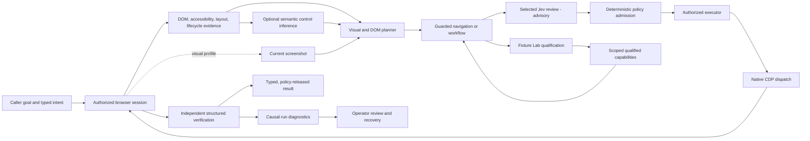

# ActiveTab

A local-first browser navigation runtime built on Chromium's native Chrome DevTools Protocol (CDP).

ActiveTab gives a coding agent a controlled way to observe and act in a real browser tab. Browser connectivity, goal interpretation, and action authorization are kept separate: model predictions are advisory, a deterministic policy admits or refuses every action, and outcomes are verified from fresh evidence after each dispatch. It does not use Playwright and has no runtime package dependencies.

ActiveTab is an experimental project developed alongside a larger browser-agent stack. Its current qualification path targets a FreeInference staging application and its Cloud Agent workflow. See [Project status](#project-status).

## Why

Browser automation harnesses usually collapse three jobs into one process: driving the browser, deciding what to do, and deciding what is allowed. That makes it hard to answer basic questions after a run: which tab was actually touched, what evidence justified a click, whether a model suggestion was accepted, and who authorized it.

ActiveTab separates those jobs. The browser layer uses native CDP only. The decision layer may consult a model, but a prediction never grants permission. The admission layer is deterministic and owned locally. A private, append-only decision episode links observations, predictions, policy decisions, dispatch receipts, and later state so an operator can investigate a failure without replaying it.

## How it works



Fixture Lab qualifies capabilities against isolated targets; its results never grant permission on a live site and never prove a live outcome. Diagnostics preserve run and decision lineage. Public-site qualification is a separate live path, not a substitute for the local baseline.

## Browser transports

ActiveTab supports three native CDP transports:

| Transport | Use | Consent model |
|---|---|---|
| Loopback CDP endpoint | Dedicated Chromium/Chrome process started with remote debugging | Target ID confirmed by an interactive prompt, or an out-of-band authorized target ID for non-interactive runs |
| Existing-profile bridge | Chrome 144+ with Remote Debugging enabled | Reads only Chrome's `DevToolsActivePort` file; requires Chrome's permission prompt |
| MV3 extension + native messaging | An existing tab in an ordinary Chrome profile | A separate **Attach to this tab** toolbar click for each page |

The extension route keeps up to eight concurrent, target-scoped grants. One tab's detach or navigation session does not replace another. MCP operations accept `targetId`, which is required whenever more than one browser session is attached. Native Messaging uses a per-user Unix socket with owner-only permissions.

## Requirements

- Node.js 22.5 or newer (uses built-in `WebSocket` and `fetch`).
- Chromium or Google Chrome with a loopback remote-debugging endpoint for manual use.
- Linux or macOS for the extension's native host; Windows native-host registration is not implemented.

There are no runtime package dependencies to install.

## Quick start

```sh
# Check the local runtime, browser mode, storage, and credential configuration.
npm start -- doctor --format markdown

# List targets on a dedicated Chrome debugging endpoint.
npm start -- targets --endpoint http://127.0.0.1:9222

# Observe one target. Observation defaults to the interaction profile (no screenshot).
npm start -- observe --target TARGET_ID --endpoint http://127.0.0.1:9222

# Run a goal with a profile and an owner-local task journal.
npm start -- run --target TARGET_ID --profile PROFILE_ID \
  --goal "Open the account page" --journal .activetab/task.json

# Inspect and export a prior run without replaying browser effects.
npm start -- inspect-run RUN_ID --format markdown
npm start -- export-trace RUN_ID --redacted --format markdown
```

`observe` profiles: `lightweight` (route/lifecycle checks), `structural` (DOM/AX/frame evidence without action candidates), `interaction` (default), and `visual` (adds a screenshot). Lightweight and structural observations cannot authorize actions. Each observation reports its profile, facet coverage, capture duration, CDP round trips, retained bytes, and node counts.

For an existing Chrome profile, enable Remote Debugging at `chrome://inspect/#remote-debugging` and use `--auto-connect`, or set `ACTIVETAB_CHROME_USER_DATA_DIR` for a non-default profile. The agent cannot authorize itself by supplying a target ID.

## MCP server

```sh
npm run mcp           # stdio MCP server over loopback CDP or the existing-profile bridge
npm run mcp:extension # stdio MCP server over the extension / native host adapter
```

Tools: `get_runtime_capabilities`, `list_tabs`, `attach_tab`, `detach_tab`, `observe_page`, `get_evidence`, `inspect_runtime_state`, `read_page_records`, `click_observed_element`, `inspect_network_response`, `request_evidence_release`, `release_evidence`, and `run_goal`. Session-scoped tools accept `targetId`.

`run_goal` defaults to `plannerMode: "auto"`: deterministic CDP resolution first, Jev only for an image-enabled unclear state, and a configured secondary model for unresolved target selection or compound navigation. `deterministic`, `model`, and `workflow` remain explicit alternatives. No endpoint or page-content consent means auto mode stays deterministic and records the skipped route.

`run_goal` saves bounded, redacted task journals in ActiveTab's local state directory. On Linux this is `$XDG_STATE_HOME/activetab/mcp-tasks` or `~/.local/state/activetab/mcp-tasks`.

## Configuration

Runtime settings are read from the environment and, for operational entrypoints, from an ignored owner-local `.env.local` file when present. The checked-in `.env.example` shows the display override. Common settings:

| Variable | Purpose |
|---|---|
| `ACTIVETAB_CDP_ENDPOINT` | Loopback CDP endpoint for a dedicated browser |
| `ACTIVETAB_AUTO_CONNECT=1` | Use Chrome's existing-session bridge via `DevToolsActivePort` |
| `ACTIVETAB_CHROME_USER_DATA_DIR` | Non-default Chrome profile directory |
| `ACTIVETAB_AUTHORIZED_TARGET_ID` | Out-of-band target authorization for non-interactive runs |
| `ACTIVETAB_MODEL_ENDPOINT` / `ACTIVETAB_SEMANTIC_ENDPOINT` | OpenAI-compatible secondary planner / semantic endpoint |
| `ACTIVETAB_MODEL` / `ACTIVETAB_SEMANTIC_MODEL` | Model IDs (default FreeInference model: `glm-5.3-flash`) |
| `ACTIVETAB_MODEL_API_KEY`, `ACTIVETAB_SEMANTIC_API_KEY`, `FREEINFERENCE_API_KEY` | Credentials, one per configured role |
| `ACTIVETAB_MODEL_ALLOW_PAGE_CONTENT=1` | Opt-in before page titles, headings, labels, and candidate facts leave the host |
| `ACTIVETAB_MODEL_ALLOW_SCREENSHOTS=1` | Separate opt-in before screenshot bytes leave the host |
| `ACTIVETAB_JEV_ALLOW_IMAGES=1` | Additional opt-in for experimental Jev image review |
| `ACTIVETAB_OPERATOR_TOKEN`, `ACTIVETAB_OPERATOR_ID` | Separate operator API identity for evidence-release approvals |
| `ACTIVETAB_TELEMETRY_DB` | Alternate local decision-event database path |
| `ACTIVETAB_WORKFLOW_STORE` | Opt-in durable workflow store |

Keep `.env.local` owner-only; it is never committed. Credentials stay private to their adapters and are not written to decision telemetry.

## Repository layout

| Path | Role |
|---|---|
| `src/api/` | Local HTTP API, run lifecycle, task store, evidence-release approval routes |
| `src/browser/` | CDP session, frame and target management, browser activity |
| `src/navigation/` | Navigation engine, workflow capabilities, visual decision coordination |
| `src/observe/` | DOM/AX/layout/network observation and frame collection |
| `src/runtime/` | Authorized executor, remote executor, token handling |
| `src/testing/` | Runners, receipts, qualification, cloud-agent workflow adapters |
| `src/integrations/freeinference/` | Staging browser and exact-run diagnostic adapters |
| `extension/`, `native-host/` | MV3 extension and native messaging host installer |
| `profiles/` | JSON capability and staging profiles |
| `test/`, `test-support/` | Integration and unit suites, disposable-browser fixtures |
| `docs/` | Engineering plan, architecture notes, qualification evidence, display map |

Further reading: [engineering plan](docs/engineering-plan.md), [architecture decomposition](docs/architecture-decomposition.md), [capability extraction](docs/capability-extraction.md), [testing display map](docs/testing-display.md).

## Testing and verification

```sh
npm test                      # isolated Chrome processes, loopback fixtures, mocked providers
npm run test:headed           # visible Chrome windows on the configured display
npm run test:headed -- --xvfb # virtual display, not visible on a physical screen
```

Integration tests use temporary browser profiles and loopback fixtures. They do not use a user's normal profile and do not contact BrowserAct SaaS. Chrome integration tests launch headed by default; `ACTIVETAB_HEADLESS=1` adds `--headless=new` to disposable test launches. The visible extension test requires `ACTIVETAB_VISIBLE_CHROME=1`.

Live provider pretests (`npm run pretest:secondary`, `pretest:jev-visual`, `pretest:multimodal`, `pretest:secondary-image`) make real protocol calls with synthetic evidence. They check request compatibility and typed responses only; they do not qualify an application, browser workflow, or target site. Public-site qualification is opt-in and accepts no arbitrary URL or mutation input.

## Privacy and security

- Observations capture bounded CDP metadata and DOM/AX/layout/frame evidence. Request and response headers and request bodies are never captured.
- URL user-info, query and fragment data, form values, and changed page text are redacted by default. Sensitive URL data is never released by MCP.
- `inspect_network_response` returns a bounded, credential-redacted projection of one selected response. Raw values require an explicit `request_evidence_release`, operator approval, a one-time token, and a grant bound to process, principal, target, evidence, facet, byte budget, and expiry.
- HTTP 429 is surfaced as a URL-free rate-limit signal and suspends the run for operator review. ActiveTab does not rotate browser identities or retry to get around a site's limit.
- Human handoff stops on visible anti-automation challenges, login prompts, or password fields. ActiveTab does not attempt to solve or bypass them.
- Decision telemetry is owner-only, append-only, and hash-chained; `export-trace` requires `--redacted` and verifies the chain before exporting.

## Project status

Experimental and under active, intermittent development. ActiveTab is tied to other applications: the Chrome DevTools Protocol and extension surface, a FreeInference staging and Cloud Agent workflow, OpenAI-compatible model routes, and the advisory TypeSafe Jev reviewer. It is not a general-purpose browser-automation product and makes no hosted-SaaS parity claim. Feature work continues as time permits and higher-priority work allows.

Known limitations:

- No `LICENSE` file is published; all rights are reserved until one is added. The npm package is marked private.
- The extension needs a separate Attach click per tab; Windows native-host registration is not implemented.
- Semantic and Jev predictions are advisory and never authorize an action. Jev image and Box paths are experimental and route-dependent.
- Screenshots require both route-reported image support and a separate consent flag; image bytes are never saved to telemetry.
- The exact-run Cloud Agent diagnostic adapter sends requests only to profile-validated routes; a health response alone is not run correlation or proof of success.
- Same-process child-frame execution contexts and closure state are not fully selected by `inspect_runtime_state`.

## Contributing

This is a personal experimental project. Issues and focused pull requests are welcome; please keep changes scoped and include the relevant test or qualification evidence.

## Disclaimer

This project is an independent, experimental work by the repository author. It is not affiliated with, directed, endorsed, or approved by FreeInference.org ("FI"). FI has no involvement in this project's design, development, or publication, and bears no responsibility for it. Every decision to create, modify, and publish this work was made by me, at my own discretion.

If you find this project useful or helpful, please consider sponsoring or otherwise supporting FreeInference.org. FI provides a useful and valuable service to people who might not otherwise have the opportunity to access this kind of tooling.
