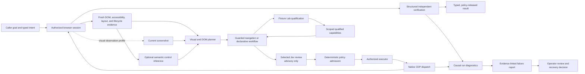

# ActiveTab

ActiveTab is a standalone, local-first browser-navigation runtime built on Chromium's native Chrome DevTools Protocol (CDP). It keeps browser connectivity separate from goal interpretation and exposes a small MCP server for agent harnesses. It does not use Playwright and has no runtime package dependencies.

The runtime supports three native CDP transports: an already-exposed loopback endpoint for dedicated browser processes, Chrome's opt-in existing-profile bridge for Chrome 144+, and an MV3 extension/native-messaging adapter for existing tabs. The extension route requires a separate **Attach to this tab** click for every page. It retains up to eight concurrent, target-scoped grants; one tab's detach or navigation session does not replace another. MCP operations accept `targetId` and require it whenever more than one browser session is attached.

## Runtime architecture



Fixture Lab qualifies capabilities against isolated targets; its results never grant permission or verify a live-site outcome. Diagnostics preserve run and decision lineage so an operator can investigate a failure without replaying browser effects.

## Requirements

- Node.js 22 or newer (uses built-in WebSocket and `fetch`).
- Chromium or Google Chrome with a loopback remote-debugging endpoint for manual use.

## Run

```sh
npm test
npm start -- doctor --format markdown
npm start -- inspect-run RUN_ID --format markdown
npm start -- inspect-run RUN_ID --format markdown --list-sections
npm start -- inspect-run RUN_ID --format markdown --section authorization-and-outcome
npm start -- export-trace RUN_ID --redacted --format markdown
npm start -- targets --endpoint http://127.0.0.1:9222
npm start -- observe --target TARGET_ID --endpoint http://127.0.0.1:9222
npm start -- run --target TARGET_ID --profile PROFILE_ID --goal "Open the account page" --journal .activetab/task.json --workflow-store ~/.local/share/activetab/workflows.json
npm start -- run --target TARGET_ID --profile PROFILE_ID --goal "Search for blue shoes" --journal .activetab/search.json
npm start -- resume --journal .activetab/task.json --profile PROFILE_ID --goal "Open the account page" --endpoint http://127.0.0.1:9222
npm start -- resume --journal .activetab/search.json --profile PROFILE_ID --goal "Search for blue shoes" --endpoint http://127.0.0.1:9222
npm start -- targets --auto-connect
npm start -- observe --target TARGET_ID --auto-connect
```

`observe` defaults to the interaction profile and does not capture a screenshot. Select `--profile lightweight` for route/lifecycle checks, `--profile structural` for DOM/AX/frame evidence without action candidates, or `--profile visual` to include a screenshot. Lightweight and structural observations cannot authorize browser actions. Every observation reports its profile, facet coverage, capture duration, CDP round trips, retained bytes, and node counts.

For an existing Chrome profile, first enable Remote Debugging at `chrome://inspect/#remote-debugging`. `--auto-connect` reads only Chrome's `DevToolsActivePort` endpoint file, opens its browser-level WebSocket with native CDP, then enumerates page targets after Chrome's permission prompt is accepted. Use `--user-data-dir PATH` or `ACTIVETAB_CHROME_USER_DATA_DIR` for a non-default profile. The CLI requires an interactive target-ID confirmation; non-interactive sessions require `ACTIVETAB_AUTHORIZED_TARGET_ID` set out of band after explicit consent. The agent cannot authorize itself by supplying a target ID.

`doctor` reports local runtime, browser-mode, storage, and credential-configuration status without printing credentials or endpoint values. `inspect-run` projects durable step, operation, evidence, and cleanup state without returning raw goals or inputs. `export-trace` requires `--redacted`, reads the existing decision database without writing, verifies its append-only hash chain, and exports run/episode/step/decision/observation lineage. Markdown reports decompose nested diagnostics into indexed tables and headings while retaining a complete data block per section; use `--list-sections` to see stable section IDs or `--section ID` to return one subtree. Numeric model usage remains visible in redacted trace output, while credentials and raw content fields remain redacted. The default telemetry path is `.activetab/telemetry/decision-events.sqlite`; `ACTIVETAB_TELEMETRY_DB` selects another local database.

The integration tests launch isolated Chrome processes with temporary profiles and loopback fixtures, including direct CDP and nested OOPIF cases. They do not use a user's normal browser profile and do not contact BrowserAct SaaS. Chrome integration tests launch headed by default; `ACTIVETAB_HEADLESS=1` adds Chrome's `--headless=new` flag to disposable test launches. The visible extension integration test additionally requires `ACTIVETAB_VISIBLE_CHROME=1` and skips when headless mode is selected.

To run the full suite in **visible Chrome windows** (not headless), use:

```sh
npm run test:headed
```

This starts a virtual X display (Xvfb) so that Chrome renders into a real X server (not headless mode). The latest verified run on Chrome 150.0.7871.114 passed **221 tests, 220 passed, 0 failed, 1 skipped**.

For headed Chrome with a visible desktop display, use:

```sh
ACTIVETAB_VISIBLE_CHROME=1 npm test -- --test-concurrency=1
```

## Public search-and-browse qualification

Fixture Lab remains the repeatable local baseline for deterministic regressions. Public-site qualification is a separate live path and exercises the configured AI architecture on a real search engine. List registered scenarios with `npm run qualify:public-sites -- --list`, then run:

```sh
npm run qualify:public-sites -- --scenario-id public-search-wikipedia-001 --confirm-readonly --allow-jev-visual
```

The run opens headed Chrome at a trusted DuckDuckGo GET URL for a random neutral topic, then lets NavigationEngine's normal automatic router choose the configured secondary model for an observed Wikipedia result. The model receives a screenshot only when startup preflight confirms image support and screenshot privacy consent is enabled. Jev's bound screenshot review remains separately opt-in. The run verifies the destination against both the browser's visible heading and a bounded independent HTTP read. Owner-only decision history and the qualification receipt persist while the temporary browser profile is deleted. Preserved history supports reconstruction, evaluation, calibration, and reviewed policy changes; it does not automatically fine-tune hosted model weights. The run accepts no arbitrary URL or mutation input.

## FreeInference Staging and Cloud Agent

Cloud Agent is reached from an authenticated FreeInference staging page by following its visible Agents/Cloud Agents link. It is a separate application page and may have a different URL; ActiveTab observes that destination instead of guessing it. Browser control and backend diagnostics remain separate paths:

| Path | Endpoint | Role |
|------|----------|------|
| Browser | Visible FreeInference staging → Agents/Cloud Agents link | The actual application under test; destination is observed at runtime |
| Control | CDP / extension broker | Transport only — never the application |
| Diagnostic | `ACTIVETAB_CLOUD_AGENT_URL` | Optional authorized backend records |

Loopback is **transport infrastructure only**. A locally forwarded address (SSH tunnel) is never the browser entry point and never counts as staging qualification.

### Browser qualification (application path)

Attach to an authorized headed Chrome tab on the real staging origin and run:

```sh
node --test test/cloud-agent-e2e.test.js
```

The test verifies environment/application identity from the observed URL, discovers the Agents application through live navigation, and — when authentication is required — enters a **durable resumable waiting state** instead of skipping the browser workflow. No step restarts from the beginning once the human action is verified. See `examples/cloud-agent/*.json` for goal-driven test packs.

### Backend diagnostics (optional diagnostic path)

The Cloud Agent backend adapter is separate from the browser session and accepts only profile-validated, exact-run diagnostic routes. Configure the service URL and credential only when those routes have been independently observed and added to the profile:

```sh
ACTIVETAB_CLOUD_AGENT_URL=https://<verified-diagnostic-service>
ACTIVETAB_CLOUD_AGENT_ADMIN_TOKEN=<the Cloud Agent ADMIN_TOKEN>
```

The checked-in staging profile currently has no diagnostic endpoint bindings, so setting these variables alone sends no request. A binding must name the exact observed GET route, its successful JSON response evidence, and an exact `{runId}` slot for run detail/activity. Loopback diagnostics also require a trusted in-process tunnel adapter to verify the remote service identity before sending the credential.

With validated bindings, the adapter can return an exact run record, bounded step metadata, and allowlisted numeric usage for a run ID first observed in the same Agents tab. It does not expose broad run lists, conversations, audit exports, settings, or sandbox inventories. A health response does not count as run correlation or proof of task success.

## Decision and application adapters

ActiveTab composes the staging browser adapter, two distinct decision-model adapters, a FreeInference workflow adapter, and the optional exact-run diagnostic adapter:

- **Browser/CDP adapter:** attaches only to the explicitly authorized tab and keeps that browser session through authentication handoff and resume.
- **Semantic adapter:** uses the configured OpenAI-compatible endpoint for bounded control-role annotations when fresh structural evidence leaves a target ambiguous. Its default FreeInference model ID is `glm-5.3-flash`; endpoint, provider ID, and model can be configured. It can identify the model selector but never chooses the requested task model.
- **Jev adapter:** built into the decision runtime and pinned to `typesafe/jev-1.14`. It reviews selected consequential or uncertain boundaries such as task submission using minimized structural evidence. A unique ordinary navigation does not incur a second model call. A service refusal or outage is recorded and falls back to deterministic local policy; a valid `needs_agent_review` prediction pauses only that proposed action.
- **FreeInference task adapter:** `start_cloud_agent_task` requires caller-supplied model ID, task prompt, expected outcome, and diagnostic scope. It first resolves a unique native form structure, calls semantic mapping only when that observation is ambiguous, then compiles the exact caller values into the generic authorized test runner. It does not invent a task or report PASS from a submit acknowledgment.
- **FreeInference entry primitive:** `enter_cloud_agent` follows the visible Agents/Cloud Agents route from the explicitly attached staging tab and verifies the task composer on that same target. It can suspend for human authentication and never submits a task; the coding agent then supplies exact values to `start_cloud_agent_task`.
- **Diagnostic adapter:** after the exact Cloud Agent run ID is visible in fresh evidence from the same Agents tab, `collect_cloud_agent_run_evidence` may request only its bound run/step/usage metadata. Independent evidence must still establish the expected outcome.

Semantic and Jev predictions, policy decisions, dispatches, and later observations are appended to the same owner-only decision episode with stable run, step, decision, and observation references. Their credentials remain private to their adapters. Model predictions never authorize a browser action, and training export requires independent labels.

To run only the extension vertical slice visibly, use:

```sh
ACTIVETAB_VISIBLE_CHROME=1 node --test test/extension.integration.test.js
```

This opt-in test opens Chrome visibly with a disposable profile, loads the unpacked extension, separately authorizes two tabs through the toolbar popup, navigates both through independent target-scoped sessions, and verifies detaching one leaves the other usable. It restores both leases after a forced service-worker restart, then continues the fixture workflow through nested out-of-process frames, records and replays a verified workflow without a planner call, injects and recovers from a stale-element failure, resumes from a task journal, and recovers from broker restart. It later closes the attached tab and restarts Chrome before requiring fresh explicit Attach clicks. The test also opens docked DevTools on the attached page. On the tested Chrome 150 build, DevTools left the extension lease active. It does not use or modify the user's normal Chrome profile. After browser restart, the test loads the unpacked extension into that profile again through CDP; it does not verify persistent extension installation without that reload.

## Existing-tab extension

1. Run `npm run native-host:setup -- --dry-run` to inspect the exact Native Messaging manifest path and contents. Add `--apply` only when you want to register the local host in that Chrome installation. Existing different manifests are left untouched.
2. In Chrome, open `chrome://extensions`, enable Developer mode, and load `/home/bamn/ActiveTab/extension` as an unpacked extension.
3. Start `npm run mcp:extension` as the MCP stdio server. On each tab to authorize, click the ActiveTab toolbar icon, then **Attach to this tab**. Each granted page appears in `list_tabs`; MCP can attach to each exact target after the extension reports its explicit click. Use `detach_tab` with that page's `targetId` to release one grant while preserving the others.

The repeatable visible benchmark is `ACTIVETAB_VISIBLE_CHROME=1 node --test test/extension.integration.test.js`. It launches disposable Chrome, runs the lifecycle/recovery/search scenario, then runs 30 tasks across ten generated loopback origins with varied semantic controls. It reports per-origin independent browser-state outcomes, selected-action checks, recovery counts, planner calls, engine latency, and approximate Chrome process-family CPU/RSS from asynchronous one-second Linux `/proc` snapshots. These are controlled fixtures; the matrix is not a sample of public websites and does not establish BrowserAct SaaS parity.

The extension has no content scripts and requests no site-wide host access. Its `chrome.debugger` permission is broad at the Chrome permission boundary; ActiveTab limits commands to the attached page and required CDP domains. Native Messaging connects through a per-user Unix socket with owner-only permissions. Closing the MCP process detaches the tab. The native host installer supports Chrome/Chromium on Linux and macOS; Windows registration is not implemented. Automated tests use disposable profiles and do not install this host in the user's Chrome configuration.

Operational npm entrypoints and live provider pretests load an ignored, owner-local `.env.local` file when present. Use it to select the local FI gateway, set the FreeInference key, and enable only the page or screenshot permissions you intend. Keep this file owner-only; it is never committed.

## Browser evidence

A newly observed HTTP 429 is surfaced as a URL-free rate-limit signal and suspends the run for operator review. ActiveTab does not retry or rotate browser identities to get around the site's limit. Resume only after the operator determines the wait is over and the runtime gathers fresh evidence.

Observations retain bounded CDP network request/response metadata, page/DOM lifecycle events, and DOM mutation deltas alongside DOMSnapshot, accessibility, layout, frame, and screenshot evidence. They also expose visible viewport and nested scroll regions through compact `scrollTargets` and the selectable `scrollTargets` evidence facet. `get_evidence` retrieves selected facets by evidence ID. Request/response headers and request bodies are never captured. `inspect_network_response` fetches only the selected response and returns a bounded, credential-redacted body projection with format diagnostics. The local inspector identifies JSON and common non-JSON formats, repairs supported loose JSON syntax, reports parse diagnostics, and renders a decomposable Markdown view. Nested JSON is broken into bounded, indexed sections and record tables; CSV/TSV, YAML line structure, event frames, and log-like text receive format-specific indexes. The complete redacted source or normalized JSON stays available separately, and the Markdown index exposes byte offsets for further decomposition. YAML analysis is explicitly a conservative line scan, not full YAML parsing. Recognized credentials remain redacted, with `credentialDetails` describing their path, kind, length, encoding clues, and (for JWTs) claim names and types without exposing values. Select `view: "markdown"`, `"source"`, or `"normalized"`; the normalized view is available when a structured JSON value can be established. `maxBytes` sets the page size (up to 256 KiB), while `offset` and `hasMore` let the caller page through the full selected view. Opaque or compressed binary data cannot be fully classified by text-based credential patterns. URL user-info, query, and fragment data, form values, and changed page text are redacted by default; sensitive URL data is never released by MCP. Screenshots can be retained with `observe_page` profile `visual`, but require separate approval before release. Clicks scroll an observed target into view, then revalidate its identity, visibility, label, and occlusion before dispatching native input. When a requested item is not currently rendered, the planner can select a uniquely relevant observed scroll region and dispatch a bounded native wheel event, then reobserve before planning again. Scrolls count against separate `maxScrolls` and total action budgets, stop if the region fails to move, and can be saved in version 2 workflows when replay can validate a fresh unique region, starting position, and visible-candidate state before and after movement.

MCP returns redacted retained DOM/AX evidence and selected response diagnostics. `inspect_network_response` returns a decomposable Markdown/source/normalized page for one request, with recognized credential values redacted and available through section/block indexes and offsets. Caller-supplied sensitive flags remain rejected. For raw values, call `request_evidence_release` with the exact target, evidence ID, profile, facet or Markdown subtree, byte budget, and expiry. This creates a pending request only. An independently authenticated operator reviews it through `GET /v1/evidence/releases/requests` and approves or rejects with `POST /v1/evidence/releases/requests/{requestId}/approve` or `/reject`, using the revision shown in the request. The response to approval contains a one-time token; pass it to `release_evidence`. Grants are bound to the MCP process that requested them, verified profile application/environment, principal, target, evidence, facet, selectors, cumulative byte budget, and expiry. Raw response credentials require separate approval for both `response_body` and `response_credential_values`; each release is audited, and operators can revoke grants through `POST /v1/evidence/releases/grants/{grantId}/revoke`. The operator API uses `ACTIVETAB_OPERATOR_TOKEN` and `ACTIVETAB_OPERATOR_ID`, separate from the normal API token. Grant records live in the owner-only `evidence-releases.sqlite` under the ActiveTab state directory; `ACTIVETAB_EVIDENCE_RELEASE_DB` selects another local path. `inspect_runtime_state` reads a caller-selected JavaScript own-property path (up to eight segments) from the main page or an attached OOPIF; it accepts no caller code, reports accessors without reading them, and asks V8 to reject operations it cannot prove side-effect-free. Sensitive values stay redacted in normal MCP runtime records. Runtime records are bounded and remain separate from planner input. Same-process child-frame execution contexts and closure state are not yet selectable. An external agent can call `click_observed_element` with the target's evidence ID and backend node ID; ActiveTab requires the same candidate in a fresh observation, applies handoff and caller-intent checks, and returns post-action evidence without claiming the goal succeeded. The internal standalone planner can send the current screenshot with compact DOM evidence in its existing planning request when image support and the separate screenshot opt-in are both enabled. Open Shadow DOM controls and nested out-of-process iframe targets are observable and controllable through native CDP. OOPIF attachment is recursive, limited to 16 attached frame targets per tab, and each child keeps its own target-scoped node IDs. Child snapshots are captured one at a time within the remaining per-observation evidence budget; omitted frames are reported in observation coverage. Use the `outOfProcessFrames` evidence facet to retrieve their DOMSnapshot and accessibility data; pass `frameTargetId` with `backendNodeId` when requesting a selected element from a child target. Closed Shadow DOM content remains unavailable.

When `run_goal` finds tied targets, it returns `unresolved` without dispatching a click and includes the tied candidates' backend node IDs, frame target IDs, context, and bounds, linked to the retained evidence ID. An agent can inspect redacted selected-element details, then call `click_observed_element` for its chosen candidate. ActiveTab checks the candidate against a fresh observation and returns post-action evidence; the agent remains responsible for deciding from that evidence whether the task is complete. If the available evidence does not distinguish the candidates, the task stays unresolved for human input; a visual observation can retain a screenshot, and its release requires an operator grant.

## Search form input

Goals in the form `Search for <phrase>` use a local deterministic path: ActiveTab requires one visible main-frame `input[type=search]`, enters the caller's phrase with native CDP keyboard input, then clicks its matching search submit control. It verifies both a changed search-results state and the phrase in the visible search field or result text. Search phrases stay out of external planner calls, navigation results, task journals, and reusable workflows. Search workflows are not recorded. Task journals and tool results omit every raw goal; journals store a normalized fingerprint, and CLI `resume` requires the caller to re-enter the same goal, which ActiveTab verifies before observing or acting. Legacy redacted search journals without a fingerprint cannot safely resume. Other free-text fields, password fields, file inputs, and form values are not filled by this path.

## MCP

The `get_runtime_capabilities` tool reports tab attachment, authorization requirements, extraction/form limits, workflow reuse state, and authenticated model-catalog findings. Catalog capability is labeled separately from a live inference probe; it never claims that a model call has been tested.

Run `npm run mcp` as an MCP stdio server. Set `ACTIVETAB_CDP_ENDPOINT` to a loopback endpoint, or set `ACTIVETAB_AUTO_CONNECT=1` to use Chrome's existing-session bridge. For auto-connect, enable Remote Debugging in Chrome and accept Chrome's permission prompt; set `ACTIVETAB_CHROME_USER_DATA_DIR` when using a non-default profile. Use `npm run mcp:extension` for the toolbar/native-host adapter; in that mode each extension Attach click supplies consent and no `ACTIVETAB_AUTHORIZED_TARGET_ID` is used. Tools include `get_runtime_capabilities`, `list_tabs`, `attach_tab`, `detach_tab`, `observe_page`, `get_evidence`, `inspect_runtime_state`, `read_page_records`, `click_observed_element`, `inspect_network_response`, `request_evidence_release`, `release_evidence`, and `run_goal`. Session-scoped tools accept `targetId`; it is required whenever multiple tabs are attached. `run_goal` defaults to `plannerMode: "auto"`: it uses deterministic CDP resolution first, calls Jev only for an image-enabled unclear page state, and sends unresolved target selection or compound navigation to the configured secondary model. Set `ACTIVETAB_MODEL_ENDPOINT` or `ACTIVETAB_SEMANTIC_ENDPOINT` to select the secondary endpoint; the model defaults to `glm-5.3-flash` and can be overridden with `ACTIVETAB_MODEL` or `ACTIVETAB_SEMANTIC_MODEL`. Credentials may use `ACTIVETAB_MODEL_API_KEY`, `ACTIVETAB_SEMANTIC_API_KEY`, or `FREEINFERENCE_API_KEY`. `ACTIVETAB_MODEL_ALLOW_PAGE_CONTENT=1` is required before page evidence can be sent; screenshot input requires a route that reports image support at startup plus `ACTIVETAB_MODEL_ALLOW_SCREENSHOTS=1`. With no configured endpoint or page-content consent, auto mode stays deterministic and records the skipped route. `plannerMode: "deterministic"`, `"model"`, and `"workflow"` remain explicit alternatives. `run_goal` saves bounded, redacted task journals in ActiveTab's local state directory. On Linux this is `$XDG_STATE_HOME/activetab/mcp-tasks` or `~/.local/state/activetab/mcp-tasks`; macOS and Windows use their standard per-user application-state paths. Set `ACTIVETAB_STATE_DIR` to move all ActiveTab state, or `ACTIVETAB_TASK_JOURNAL_DIR` to use another absolute journal path. Repeating the same goal on the same target resumes an incomplete task, and a completed task returns idempotently. Pass `newTask: true` to start that goal again. Before each native action, ActiveTab atomically journals a redacted pending-action record; after a restart it takes fresh evidence, reconciles the uncertain action, and does not blindly replay the same target. Journals omit raw goals and browser evidence, use owner-only file permissions, cap each task record at 64 KiB, and retain resumable tasks when the configured 128-task capacity is full. Concurrent `run_goal` calls for one target are rejected while that target has an active navigation. Set `ACTIVETAB_WORKFLOW_STORE=/path/to/workflows.json` to opt in to local workflow recording and replay; MCP uses that configured store by default, and `reuseWorkflows: false` disables it for one run.

When a caller marks extraction capability IDs as required in `workflowIntent`, also set `plannerMode: "workflow"`. With `ACTIVETAB_MODEL_ALLOW_GOAL_TEXT=1`, workflow mode can infer a unique matching qualified read capability from a natural-language extraction goal without exposing capability IDs to the caller. On complete verification, the MCP runner atomically writes policy-released results to a separate owner-only `result-artifacts` directory before journaling success. A repeat returns those results only when the same goal, target, environment, principal, caller intent when supplied, qualified capability manifests, current release policy, and extraction verification still match. Task journal files continue to contain no extracted record values; completed artifact files are removed when their journals are pruned. Mid-run extraction checkpoints are not persisted: an interrupted required extraction remains unresolved and must be rebuilt with `newTask: true`.

## Human handoff

ActiveTab stops with `needs_human` when visible evidence strongly indicates an anti-automation challenge, a login route/prompt, or a visible password field. The result includes a handoff category and evidence ID. Complete the challenge or login manually in the authorized tab, then resume; ActiveTab does not attempt to solve or bypass it. On explicit resume, the journal records the original handoff evidence and fresh evidence that the detector no longer sees the condition, then clears the active handoff marker. This records observed state; it does not claim ActiveTab solved the challenge. Text and URL detection cannot identify visual-only challenges.

## Workflow reuse

CLI runs can opt in with `--workflow-store PATH`; use the same path for later runs and `resume`. MCP clients opt in by setting `ACTIVETAB_WORKFLOW_STORE`; the configured store is used by default, and `reuseWorkflows: false` disables persistence and replay for one run. Without a configured store, ActiveTab does not persist or replay workflows.

For a profile-free, read-only CLI navigation run, `--scope current-origin` creates a temporary binding for the selected tab's observed origin. An interactive run requires typing that exact origin; a non-interactive run requires `ACTIVETAB_AUTHORIZED_ORIGIN` to match it, set out of band after consent. The grant lasts for the run, permits navigation only within that origin, and contains no form or mutation operation grants. Use a profile for cross-origin navigation, authenticated application work, or application operations.

Only fully verified tasks are recorded. Version 2 replay resolves each saved click signature and scroll region against fresh visible evidence, validates the route and scroll position, compares visible-candidate fingerprints before and after scrolling, rechecks caller intent, and verifies the requested outcome. A stale route, target, list position, or candidate set invalidates the trace and continues through bounded fresh planning. Version 1 click-only workflows remain readable. Workflow files are capped and owner-only; they store hashes for goals, routes, labels, contexts, links, and candidate sets, plus structural region kind/tag/role and bounded scroll-position fractions. They omit raw labels, node identities, screenshots, form values, and authentication data.

## Optional model planner

Standalone entrypoints default to `plannerMode: "auto"`: fresh DOM/AX evidence is resolved locally first, and the secondary model is called for unresolved candidate selection or compound navigation. Configure `ACTIVETAB_MODEL_ENDPOINT` or `ACTIVETAB_SEMANTIC_ENDPOINT`; the default FreeInference model ID is `glm-5.3-flash`, with optional `ACTIVETAB_MODEL` / `ACTIVETAB_SEMANTIC_MODEL` overrides and API keys from `ACTIVETAB_MODEL_API_KEY`, `ACTIVETAB_SEMANTIC_API_KEY`, or `FREEINFERENCE_API_KEY`. `ACTIVETAB_MODEL_ALLOW_PAGE_CONTENT=1` is required before page titles, headings, labels, and candidate facts are sent to the planner endpoint. Set `ACTIVETAB_MODEL_REASONING_EFFORT` to tune reasoning and `ACTIVETAB_MODEL_MAX_RETRIES` to bound client retries. When using the local FI gateway, prefer low reasoning effort and zero client retries because the gateway owns upstream retry admission. On CLI task runs, staging qualification, API startup, and MCP startup, ActiveTab checks each configured model's authenticated `/models` catalog and derives image capability per role. If the catalog cannot report capability, `ACTIVETAB_MODEL_IMAGE_INPUT=1` can serve as an explicit fallback declaration. Screenshot transmission still separately requires `ACTIVETAB_MODEL_ALLOW_SCREENSHOTS=1`; this privacy opt-in is independent of page-text transmission. Screenshot-capable planner calls include the bound image with the structured observation, and can select only identities from that observation. Workflow mode resolves simple navigation goals to the existing generic navigation contract. For unresolved goals, set `ACTIVETAB_MODEL_ALLOW_GOAL_TEXT=1` to let workflow synthesis choose one fixed, qualified read contract only when the request has a read/retrieval verb, contains no state-changing intent, and its trusted metadata has a unique highest lexical match; ties abstain. Mutations, submissions, mixed-effect requests, unrelated read contracts, and partial deterministic fallbacks remain unavailable. The inferred cardinality stays `unknown`. This goal-text opt-in is separate from page-evidence and screenshot consent. Without the page-content opt-in, the automatic planner stays local even if endpoint details are configured; without screenshot consent, model calls stay text-only.

Every interaction observation now carries a bounded `semanticPage` derived from the same fresh DOMSnapshot and candidates. Standalone model requests receive a compact projection limited to eligible candidates, with evidence-linked region, form, collection, and control relationships and separate page/task-scope coverage. Labels retain observed/inferred/unknown status; operation meanings and effects stay unknown, and visible collection counts do not prove completeness. These relationships help the model interpret context but cannot grant an operation or permission.

These settings enable screenshot input but do not trigger capture on their own. A semantic request must explicitly ask for visual evidence, workflow synthesis must receive a bound image, and Jev visual review runs only at a selected ambiguity or explicit visual-decision boundary. Jev image review requires the additional `ACTIVETAB_JEV_ALLOW_IMAGES=1` setting. Screenshots are bound to the exact observation, target, document generation, and viewport; image bytes are never saved to decision telemetry.

Jev's image and Box paths are experimental, and behavior may vary by route. TypeSafe's image limits are enforced by ActiveTab as 280–1,568 pixels per side and 78,400–2,458,624 pixels total, with an additional 1.5 MB local cap. OpenRouter's multimodal guide currently documents a 256-pixel minimum, so ActiveTab intentionally applies the stricter bound cited by TypeSafe; this rejects the 256–279 range even if a route accepts it. Large viewport images are downsampled through CDP; small images are never enlarged. The typed telemetry records original viewport and device scale, actual JPEG dimensions, the pixel transform and digest, but no image bytes. Jev remains advisory. Review the [OpenRouter multimodal limits](https://openrouter.ai/docs/guides/community/multimodal-decisions), [Jev guide](https://openrouter.ai/docs/guides/community/jev), and [TypeSafe Jev 1.14 release notes](https://typesafe.ai/blog/jev-1-14) before enabling it in a workflow.

`npm run pretest:secondary`, `npm run pretest:jev-visual`, and `npm run pretest:multimodal` make live provider protocol calls using synthetic evidence and, for image paths, the static `docs/assets/first-run.jpg` image. They check request compatibility and typed responses only; they do not qualify an application, browser workflow, or target site. The Jev visual pretest checks both page classification and a paired Noul/Box response. The text-only secondary pretest requires `ACTIVETAB_MODEL_ALLOW_PAGE_CONTENT=1` plus `ACTIVETAB_SEMANTIC_ALLOW_PAGE_LABELS=1`. `npm run pretest:secondary-image` sends the synthetic screenshot to the configured secondary model and checks a typed visual answer. Image support is route-specific; verify the authenticated endpoint instead of inferring modality from a model name. Successful output says `pretest_passed` to make that scope explicit. These probes perform no browser actions and stay separate from `npm test`, whose providers remain mocked.

In the local API and MCP runtimes, workflow planning can include qualified extraction capabilities from the configured registry when the run has an explicit environment and principal binding. Both load `ACTIVETAB_CAPABILITY_DIR` (default `.activetab/capabilities`) and `ACTIVETAB_EXTRACTION_POLICY_FILE`; unlisted fields are neither readable nor releasable. One-shot public reads without a profile require a separate exact-origin `publicReadEntries` allowlist and remain `observed_partial`. Put a registered capability ID in `workflowIntent.requiredCapabilityIds` when that output is required; synthesis must include it and cannot skip it conditionally. With goal-text egress enabled, synthesis may choose one matching qualified read contract without requiring the caller to know its capability ID. The model receives only registered field names and types; the capability reads fresh retained DOM evidence locally, and output is returned only after field-release policy plus schema, provenance, uniqueness, and completeness checks pass. MCP stores verified inferred outputs in owner-only artifacts so a repeated request can return them only while the target, environment, principal, qualified manifest, release policy, and extraction verification still match. Registered `rel_next_same_path` recipes can collect multiple pages through the shared bounded collector; each page advance is freshly checked and dispatched through the authorized executor under the active target lease.

## Built-in decision review and telemetry

Browser execution records a private, append-only decision episode in `.activetab/telemetry/decision-events.sqlite`. It links observed control resolution, semantic annotation when needed, Jev review or explicit review skips, deterministic policy decisions, dispatch receipts, and later observed state. Jev is built into the runtime and pinned to `typesafe/jev-1.14`; its private credential is read from `JEV.txt` (or the path in `ACTIVETAB_JEV_KEY_FILE`) and is never written to telemetry or logs. If Jev is unavailable, ActiveTab records that failure and ordinary local navigation continues.

At CLI task, staging qualification, API, and MCP startup, a bounded authenticated catalog preflight discovers input modalities for configured secondary-model roles. It records one training-excluded `model.capability_preflight` event per role; it does not send a prompt, page content, or image. Each model input and route event records whether that particular call used text only or text plus visual evidence. A catalog failure leaves text inference available and uses an explicitly configured image capability only as a fallback.

For semantic control mapping, configure `ACTIVETAB_SEMANTIC_ENDPOINT` (or reuse `ACTIVETAB_MODEL_ENDPOINT`) and optionally `ACTIVETAB_SEMANTIC_API_KEY`, `ACTIVETAB_MODEL_API_KEY`, or `FREEINFERENCE_API_KEY`. The default FreeInference model ID is `glm-5.3-flash`; `ACTIVETAB_SEMANTIC_MODEL` can select another OpenAI-compatible model. This annotation role sends a bounded projection of observed roles, tags, candidate references, accessible control names, and nearby headings to that explicitly configured endpoint. Those labels are untrusted page data and are not stored in decision telemetry; form values and URL data remain excluded by the observation contract. The optional planner above is a separate role with its own page-content opt-in. Image capability is preflighted per route, while `ACTIVETAB_MODEL_ALLOW_SCREENSHOTS=1` remains the separate screenshot consent gate. Jev image decisions remain experimental and independently opt-in.

Predictions remain advisory and do not grant permission. Telemetry copies of inputs and outputs stay in the owner-only event store. It captures semantic structural inputs before each request, including the exact candidate projection when page labels are off. If page labels are explicitly enabled, their text is not retained and that semantic input is excluded from training export. Jev input projections are recorded before review. Dataset export still requires an independently approved label, and ActiveTab does not train models automatically.

## Investigation

See [the technical findings, architecture, REA edit plan, roadmap, and benchmark criteria](docs/engineering-plan.md), and [the real-Chrome Account-page screenshot](docs/assets/first-run.jpg).

 BrowserAct claims are evidence-labeled; no hosted SaaS task or parity benchmark was available.
