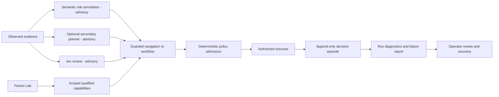

# ActiveTab

ActiveTab is a local-first browser navigation runtime built directly on Chromium's Chrome DevTools Protocol. It lets a developer or coding agent control an authorized tab, observe real browser state, navigate sites, perform guarded browser actions, verify outcomes from fresh evidence, and keep an auditable record of the decisions behind every action.

Browser transport, planning, authorization, execution, and verification are separate. Model output is advisory; a deterministic local policy admits or refuses each action, and no browser effect is reported as successful until independent post-action evidence confirms it. Control and authorization stay on the local machine. ActiveTab uses native CDP, not Playwright, and has no runtime package dependencies.

**Status: experimental.** Browser transports and deterministic navigation are implemented with automated test coverage; qualification is scoped to isolated fixtures and opt-in live paths. Not a complete browser application and not a production-ready replacement for established automation frameworks.

## Contents

- [What it gives you](#what-it-gives-you)
- [Architecture](#architecture)
- [Browser connectivity](#browser-connectivity)
- [Requirements](#requirements)
- [Quick start](#quick-start)
- [An authorized navigation workflow](#an-authorized-navigation-workflow)
- [Agent integration](#agent-integration)
- [Configuration](#configuration)
- [Privacy and security](#privacy-and-security)
- [Implementation and qualification status](#implementation-and-qualification-status)
- [Known limitations](#known-limitations)
- [Testing and verification](#testing-and-verification)
- [Deeper documentation](#deeper-documentation)
- [Contributing](#contributing)
- [License](#license)
- [Disclaimer](#disclaimer)

## What it gives you

| Capability | What it provides |
|---|---|
| Authorized tab control | Attach only to tabs authorized by prompt, Chrome permission, or an explicit toolbar click |
| Real browser observation | Bounded DOM, accessibility, layout, frame, lifecycle, and optional screenshot evidence |
| Guarded navigation | Deterministic local resolution with optional model-assisted candidate selection |
| Verified outcomes | Post-action evidence is required before a result is released |
| Auditable decisions | Private append-only, hash-chained decision episodes with redacted inspection and export |
| Local control | No hosted SaaS dependency; optional model routes only when explicitly configured and consented |

## Architecture

Two views keep the boundary readable. First, the browser interaction and authorization path:

```mermaid
flowchart LR
  Caller[Caller goal or typed intent] --> Session[Authorized browser session]
  Session --> Observe[Observe via native CDP]
  Observe --> Facts[DOM, AX, layout, frames, lifecycle]
  Facts --> Candidates[Candidate actions]
  Candidates --> Policy[Deterministic policy admission]
  Policy --> Executor[Authorized executor]
  Executor --> CDP[CDP dispatch]
  CDP --> Browser[Attached tab]
  Browser --> Fresh[Fresh post-action evidence]
  Fresh --> Verify[Independent verification]
  Verify --> Result[Typed, policy-released result]
```



Observations become candidate actions, never permissions. A model may help select among observed candidates; only the local policy admits an action. After dispatch, a new observation is the evidence used to verify the outcome.

Second, the planning, qualification, and diagnostics path:



Fixture Lab qualifies capabilities against isolated targets; its results never grant permission on a live site and never prove a live outcome. Model predictions, including Jev, never authorize an action.

## Browser connectivity

| Transport | When to use | Required setup | Consent | Session scope | Platform limits |
|---|---|---|---|---|---|
| Loopback CDP endpoint | Dedicated Chromium or Chrome process started with remote debugging | Debug port on loopback | Interactive target-ID confirmation, or `ACTIVETAB_AUTHORIZED_TARGET_ID` set out of band | Exact page target; multiple sessions require `targetId` | Linux, macOS, Windows browser process |
| Existing-profile bridge | Working inside an existing Chrome 144+ profile | Enable Remote Debugging at `chrome://inspect/#remote-debugging`; `--auto-connect` reads only `DevToolsActivePort` | Chrome's permission prompt plus exact target-ID confirmation | Exact page target, preserved across resume | Chrome 144+; non-default profile via `ACTIVETAB_CHROME_USER_DATA_DIR` |
| MV3 extension + native messaging | Authorizing an existing tab without a debug port | Load `extension/` unpacked; register the native host with `npm run native-host:setup` | A separate **Attach to this tab** toolbar click per page | Up to eight concurrent target-scoped grants; detach affects only one tab | Linux and macOS native host; Windows registration not implemented |

A target identifier alone never confers authorization. Non-interactive sessions require the out-of-band authorized-target variable after explicit consent; the agent cannot authorize itself by supplying an ID. The extension has no content scripts and requests no site-wide host access; its `chrome.debugger` permission is broad at the Chrome boundary, so ActiveTab limits commands to the attached page and required CDP domains.

## Requirements

- Node.js 22.5 or newer (built-in `WebSocket` and `fetch`).
- Chromium or Google Chrome with a loopback remote-debugging endpoint for manual use.
- For the extension: Linux or macOS; a per-user Unix socket with owner-only permissions. Windows native-host registration is not implemented.
- No runtime package dependencies to install.

## Quick start

```sh
# 1. Verify the local runtime, browser grant readiness, model config, profiles, and storage.
npm start -- doctor --format markdown

# 2. List targets on a dedicated Chrome debugging endpoint.
npm start -- targets --endpoint http://127.0.0.1:9222

# 3. Observe one target (interaction profile by default; no screenshot).
npm start -- observe --target TARGET_ID --endpoint http://127.0.0.1:9222

# 4. Run an authorized goal bound to a local profile and an owner-local journal.
npm start -- run --target TARGET_ID --goal "Open the account page" \
  --profile PROFILE_ID --journal .activetab/task.json

# 5. Inspect the run and export a redacted trace.
npm start -- inspect-run RUN_ID --format markdown
npm start -- export-trace RUN_ID --redacted --format markdown

# 6. Start an MCP stdio server, or the extension adapter.
npm run mcp
npm run mcp:extension
```

`observe` profiles: `lightweight` (route and lifecycle), `interaction` (default, DOM/AX candidates), `structural` (DOM/AX/frame evidence without action candidates), and `visual` (adds a screenshot). Lightweight and structural observations cannot authorize actions. `inspect-run` accepts `--list-sections` and `--section ID` for focused Markdown output; `export-trace` requires `--redacted`, verifies the append-only hash chain, and never writes to the decision database.

## An authorized navigation workflow

The following is command syntax, not a record of a successful run. Results depend on the target, profile, and policy.

```sh
# Authorize a dedicated browser target out of band, then list what is visible.
npm start -- targets --endpoint http://127.0.0.1:9222

# Gather evidence before deciding on an action.
npm start -- observe --target TARGET_ID --endpoint http://127.0.0.1:9222 \
  --profile structural

# Run a deterministic navigation with an environment profile and a task journal.
npm start -- run --target TARGET_ID --goal "Open the account page" \
  --planner-mode deterministic --profile PROFILE_ID \
  --journal .activetab/task.json --endpoint http://127.0.0.1:9222

# Resume requires the same goal and profile/scope authorization.
npm start -- resume --journal .activetab/task.json \
  --goal "Open the account page" --profile PROFILE_ID

# Review the recorded lineage without replaying browser effects.
npm start -- inspect-run RUN_ID --format markdown --list-sections
npm start -- export-trace RUN_ID --redacted --format markdown
```

A run returns a typed, policy-released result only after verification; an unresolved target, a human-handoff condition, or a rate limit leaves the task unresolved rather than reporting success. For a profile-free read-only run, `--scope current-origin` asks for the observed origin in an interactive run; non-interactive runs require `ACTIVETAB_AUTHORIZED_ORIGIN` set out of band to that exact origin. That temporary scope adds no form or mutation operations.

## Agent integration

ActiveTab exposes MCP over stdio. Source inspection found no ACP server in this repository, so do not assume an ACP-native integration; an MCP-capable agent is the supported path.

```sh
npm run mcp                       # loopback CDP or existing-profile bridge
npm run mcp:extension             # extension / native host adapter
ACTIVETAB_EXTENSION=1 npm run mcp # extension mode via the standard MCP entrypoint
npm run api                       # local operator API for evidence-release approvals
```

The 32 MCP tools group as follows:

| Group | Tools | Notes |
|---|---|---|
| Session | `get_runtime_capabilities`, `list_tabs`, `attach_tab`, `detach_tab` | Listing alone grants no control; `targetId` is required when multiple tabs are attached |
| Observation and evidence | `observe_page`, `get_evidence`, `inspect_runtime_state`, `inspect_network_response`, `read_page_records` | Evidence is redacted; sensitive values need operator-mediated release |
| Action | `click_observed_element`, `run_goal` | A click must still appear in fresh evidence; the caller decides whether the task is complete |
| Release control | `request_evidence_release`, `release_evidence` | A request only creates a pending item; an authenticated operator approves through the local API |
| Discovery and diagnosis | `discover_application`, `investigate_failure`, `collect_diagnostics`, `get_test_report` | Read-only; diagnostics do not replay effects |
| Workflow and run control | `start_test_run`, `resume_test_run`, `get_test_run`, `cancel_test_run`, `get_run_state`, `cancel_run`, `run_goal` | Declarative DAG runs with durable resume bindings |
| Human intervention | `list_pending_interventions`, `get_pending_intervention`, `acknowledge_human_action`, `request_operation_approval`, `reject_operation`, `resume_run` | An MCP client cannot approve its own requested effects |
| FreeInference staging | `enter_cloud_agent`, `start_cloud_agent_task`, `collect_cloud_agent_run_evidence` | Exact caller-supplied values; no invented task or model choice; a submit acknowledgement is not PASS |

`run_goal` supports `plannerMode` values `deterministic`, `auto`, `model`, and `workflow`. Auto resolves locally first, uses Jev only for an unclear image-enabled state, and calls a configured secondary model for unresolved navigation. Workflow mode synthesizes one guarded workflow from typed intent. Screenshot input requires both a route that reports image support at startup and `ACTIVETAB_MODEL_ALLOW_SCREENSHOTS=1`; Jev image review additionally requires `ACTIVETAB_JEV_ALLOW_IMAGES=1`. These are experimental and route-dependent.

## Configuration

Runtime settings come from the environment and, for operational entrypoints, an ignored owner-local `.env.local` file when present. `cat .env.example` shows the display override. Common settings:

| Variable | Purpose |
|---|---|
| `ACTIVETAB_CDP_ENDPOINT` | Loopback CDP endpoint for a dedicated browser |
| `ACTIVETAB_AUTO_CONNECT=1` | Use Chrome's existing-session bridge via `DevToolsActivePort` |
| `ACTIVETAB_EXTENSION=1` | Use the extension/native-host adapter in the standard MCP entrypoint |
| `ACTIVETAB_CHROME_USER_DATA_DIR` | Non-default Chrome profile directory |
| `ACTIVETAB_AUTHORIZED_TARGET_ID` | Out-of-band target authorization for non-interactive runs |
| `ACTIVETAB_AUTHORIZED_ORIGIN` | Out-of-band origin authorization for `--scope current-origin` |
| `ACTIVETAB_MODEL_ENDPOINT`, `ACTIVETAB_SEMANTIC_ENDPOINT` | OpenAI-compatible planner / semantic endpoints |
| `ACTIVETAB_MODEL`, `ACTIVETAB_SEMANTIC_MODEL` | Model IDs; default FreeInference model `glm-5.3-flash` |
| `ACTIVETAB_MODEL_API_KEY`, `ACTIVETAB_SEMANTIC_API_KEY`, `FREEINFERENCE_API_KEY` | Credentials per configured role |
| `ACTIVETAB_MODEL_ALLOW_PAGE_CONTENT=1` | Opt-in before page text leaves the host |
| `ACTIVETAB_MODEL_ALLOW_GOAL_TEXT=1` | Separate opt-in before natural-language goal text leaves the host |
| `ACTIVETAB_MODEL_ALLOW_SCREENSHOTS=1` | Separate screenshot consent |
| `ACTIVETAB_JEV_ALLOW_IMAGES=1` | Additional opt-in for experimental Jev image review |
| `ACTIVETAB_OPERATOR_TOKEN`, `ACTIVETAB_OPERATOR_ID` | Operator API identity for evidence approvals, separate from the normal API token |
| `ACTIVETAB_API_PORT`, `ACTIVETAB_API_TOKEN` | Local API listener configuration |
| `ACTIVETAB_TELEMETRY_DB` | Alternate local decision-event database path |
| `ACTIVETAB_WORKFLOW_STORE` | Opt-in durable workflow store |

Keep `.env.local` owner-only; it is never committed. Credentials stay private to their adapters and are not written to decision telemetry.

## Privacy and security

- Observations capture bounded CDP metadata and DOM/AX/layout/frame evidence. Request and response headers and request bodies are never captured.
- URL user-info, query and fragment data, form values, and changed page text are redacted by default. Sensitive URL data is never released by MCP.
- `inspect_network_response` returns a bounded, credential-redacted projection of one response. Raw values require `request_evidence_release`, operator approval, a one-time token, and a grant bound to process, principal, target, evidence, facet, byte budget, and expiry. Response credential values need both a body grant and a separate credential-values grant.
- `inspect_runtime_state` reads one JavaScript own-property path without evaluating caller code. Some primitive values remain redacted; the separately authenticated release path is not complete, and same-process child-frame contexts are not yet selectable.
- A newly observed HTTP 429 is a URL-free rate-limit signal that suspends the run for operator review. ActiveTab does not rotate browser identities or retry to bypass a site's limit.
- Human handoff stops on visible anti-automation challenges, login prompts, or password fields. ActiveTab does not attempt to solve or bypass them.
- Optional model integrations may send permitted page evidence, and with separate opt-ins goal text or screenshots, off-host to the explicitly configured endpoint. Without consent, auto mode stays deterministic.
- Decision telemetry is owner-only, append-only, and hash-chained. `export-trace` requires `--redacted` and verifies the chain before exporting.
- Fixture Lab results are scoped to isolated targets. Public-site qualification is a separate opt-in live path, not a substitute for the local baseline.

## Implementation and qualification status

| Area | Implemented | Automated test coverage | Qualified / live evidence |
|---|---|---|---|
| Loopback CDP transport | yes | integration tests with disposable Chrome | Fixture Lab and opt-in public-site scenario |
| Existing-profile bridge | yes | autoconnect tests | Requires Chrome permission prompt; no general site qualification |
| MV3 extension transport | yes | visible extension integration test | Disposable profiles; not a public-site sample |
| Deterministic navigation and search | yes | unit and integration tests | Scoped fixtures |
| Operator evidence release | yes | API and MCP tests | Requires authenticated operator channel |
| Declarative workflow runs | yes | runner and lifecycle tests | Fixture Lab scoped capabilities |
| Semantic / secondary planner | yes | protocol pretests with synthetic evidence | Route-specific; not an application qualification |
| Jev advisory review and image paths | yes, advisory | pretests and unit tests | Experimental; route-dependent |
| FreeInference staging Cloud Agent adapters | yes | staging qualification scripts | Exact observed routes only; not general production |
| Windows native-host registration | no | n/a | n/a |
| ACP server | no | n/a | n/a |
| Full runtime-state inspection | partial | unit tests | Same-process child-frame contexts not selectable |

## Known limitations

- No `LICENSE` file is published; all rights are reserved until one is added. The npm package is marked private.
- The extension needs a separate Attach click per tab and does not support Windows native-host registration.
- Jev image and Box paths are experimental and vary by route; Jev remains advisory and its outage falls back to local policy.
- Screenshots require route-reported image support and separate consent; image bytes are never saved to decision telemetry.
- The exact-run Cloud Agent diagnostic adapter sends requests only to profile-validated routes; a health response alone is not run correlation or proof of success.
- Universal support for complex websites is not claimed. Tied targets can remain unresolved for human input.
- `inspect_runtime_state` cannot select same-process child-frame execution contexts or closure state.

## Testing and verification

```sh
npm test                      # isolated Chrome processes, loopback fixtures, mocked providers
npm run test:headed           # visible Chrome windows on the configured display
npm run test:headed -- --xvfb # virtual display, not visible on a physical screen
```

Integration tests use temporary browser profiles and loopback fixtures. They do not use a user's normal profile and do not contact BrowserAct SaaS. Chrome tests launch headed by default; `ACTIVETAB_HEADLESS=1` adds `--headless=new` to disposable launches. Live provider pretests (`npm run pretest:secondary`, `pretest:jev-visual`, `pretest:multimodal`, `pretest:secondary-image`) make real protocol calls with synthetic evidence; they check compatibility and typed responses only, not an application, browser workflow, or target site.

## Deeper documentation

- [Engineering plan](docs/engineering-plan.md) - findings, architecture notes, roadmap, and benchmark criteria
- [Architecture decomposition](docs/architecture-decomposition.md) - module boundaries
- [Capability extraction](docs/capability-extraction.md) - qualified extraction contracts
- [Testing display map](docs/testing-display.md) - monitor layout and headed-test overrides
- [Local semantic query](docs/local-semantic-query.md) - local evidence query path
- [Response inspection benchmark](docs/response-inspection-benchmark.md) - format diagnostics evidence
- [Evidence index](docs/evidence/README.md) - qualification artifacts

## Contributing

This is a personal experimental project. Issues and focused pull requests are welcome; keep changes scoped and include the relevant test or qualification evidence.

## License

No `LICENSE` file is published. All rights are reserved until one is added. The npm package is marked private; do not assume an open-source license from the presence of source files.

---

## Disclaimer

This is an independent project by the repository author. FreeInference.org ("FI") did not sponsor, commission, direct, review, approve, or endorse it, and has no involvement in its design, development, or publication. Every decision to create, modify, and publish this work was made by me at my own discretion.

The inference access FI supplied was vital in bringing this project to its current state. If you find this project useful or helpful, I encourage you to support FreeInference.org through the donation options on their website. FI provides a vital service for independent developers and researchers who would otherwise lack access to this kind of infrastructure, and sustained community support is what keeps that access available.
