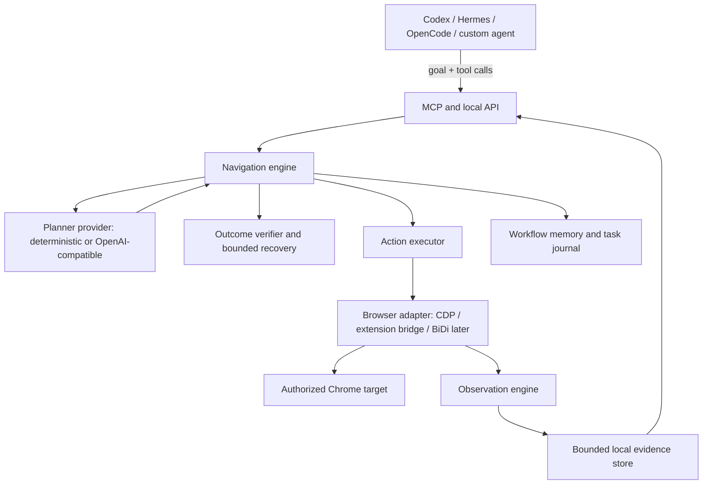

# BrowserAct Capability Findings and ActiveTab Engineering Plan

## Scope and evidence labels

This investigation uses pinned public source, the installed BrowserAct CLI 1.4.2 and its version-matched skill output, successful REA static Evidence for selected V2 and V3 client sources, and real local Chrome/CDP integration tasks. REA analysis was run through the host process path because the sandboxed child-process pipe dropped the worker protocol; only the successful Evidence is used for semantic findings. It did not run a BrowserAct SaaS task. In this session, `browser-act get-skills core --skill-version 2.0.2` reports `api_key: not configured`, `headed: supported`, and no active sessions; its configured browser entries are unrelated CloudLab contexts, not a BrowserAct comparison session. The current process and local Cloud Agent `.env.local` also have no BrowserAct key setting. A read-only search of the running local Cloud Agent database found zero BrowserAct matches in `agent_thread_messages` and zero in `agent_job_events`.

- **Observed**: directly present in the local installed client or checked-out source.
- **Verified locally**: exercised in the ActiveTab code or a real disposable browser.
- **Inference**: a design conclusion supported by evidence, not a claim about BrowserAct internals.
- **Unknown**: unavailable from the inspected evidence.

No hosted service, paid authorization, CAPTCHA bypass, private server implementation, compiled-module decompilation, or licensing control was accessed.

## A. BrowserAct technical findings

### What the inspected artifacts establish

| Evidence | Confirmed finding | Limit |
|---|---|---|
| `browseract-api-examples` at `3f14e981521a8153ffe1dc2655ef53ad52a4e004`; REA Evidence [`ev_747c4cd6ebf06fc6f3ec4d3dbaed4808f5dfc74e12926a81c6b6bd5eea9d226b`](evidence/browseract-api-examples-v2-rea-evidence.json) | The pinned examples enumerate 11 workflow operations, including run, stop/resume, task status/detail, workflow/template discovery, and regions. REA bound the directory to SHA-256 `58704118944b686981967917c32d32144bf6b7ec6c20cce426f313b5661471cb`; a typed route trace, Evidence [`ev_1f7548a812dfc8a9c034c13d8c2a84a62a44023307985a38e5f8c50dfe7c2eab`](evidence/browseract-api-examples-v2-run-task-trace.json), matched `/v2/workflow/run-task` in both `Workflow-NodeJs/1.runTask.js` and `Scenarios-NodeJs/scenario1_runAndWait.js`. | REA selected 5 source files; 9 relevant files remained unselected. Application and semantic graphs are partial. Its five request nodes have no resolved endpoint property, so the route trace establishes source locations, not a complete request contract or a live server response. [Pinned source](https://github.com/browser-act/browseract-api-examples/tree/3f14e981521a8153ffe1dc2655ef53ad52a4e004) |
| V2 task detail example at the same revision | Sample step records contain a goal, prior-goal evaluation, status, and screenshot URL field. | The response is hard-coded; screenshot values are placeholders. It does not show a live visual grounding or recovery trace. |
| `n8n-nodes-browseract` at `46e4ecd1645a786797678b9ac1fc9447628b013f`; REA Evidence [`ev_9977605e24255ce1ca3fcd28875573174bb5181f39c71566e85bb491a43437ec`](evidence/browseract-n8n-v3-rea-evidence.json) | REA bound the pinned directory to SHA-256 `e6ed53cdd876c9d1aa6dc593a836aa9ec5427bb0aa48a5bcf6627d8d37109a6d` and analyzed five selected TypeScript sources. Its static facts include `/v3/bots` and `https://api.browseract.com/v3/bots` in `helper.ts`; direct source inspection shows the client polls every five seconds, recognizes `finished`, `canceled`, and `failed`, fetches terminal details, and cancels on its configured timeout. | The application graph (61 nodes, 82 edges) and semantic graph (2,069 nodes, 1,803 relations, 674 unknowns) are partial; 11 inventoried files were outside analysis scope. The adapter delegates HTTP to n8n's authenticated request helper; REA retained zero request-family relations and six unknowns, so endpoint/method construction remains source-derived. These are client choices, not hosted navigation behavior; the adapter is not full JSON Schema. [Pinned source](https://github.com/browseract-ai/n8n-nodes-browseract/tree/46e4ecd1645a786797678b9ac1fc9447628b013f) |
| `browseract-workflow` at `8f0adf6ba7ef05caa46ef1faeb19e54305dcf860` | Three substantive workflow exports demonstrate e-commerce compositions. | They do not expose how the hosted browser agent perceives or navigates pages. |
| Deprecated `browseract` examples at `ef95a63c8a987d31ffdaf41faeda74b6928d2ab1` and historical commit `a0eb4c21c17db3b66a2506631b4b8aeaf4fdeeb8` | A prior Agent example API was removed from that repository; the removal commit described the Agent as beta and not usable by API at that time. | Repository deletion does not prove the current server API is absent. |
| Installed BrowserAct CLI 1.4.2 and `browser-act get-skills core --skill-version 2.0.2` | The local client documents an Open → State → Interact → Verify → Close loop. State indices are temporary and must be reacquired after page changes. It documents Chrome, chrome-direct, and stealth modes, screenshots, DOM extraction, common actions, request inspection, and multiple sessions/windows. In this Codex session it reports no configured API key and no active sessions. The official CLI installation guide says local `chrome` and `chrome-direct` work without a key; the key enables stealth features and managed proxies ([guide](https://github.com/browser-act/skills/blob/main/docs/installation.md)). | Client instructions and environment status, not an observed SaaS task or a complete autonomous planner contract. Its configured browser records were unrelated to this investigation, so none was selected or operated. |
| Current official BrowserAct Workflow API docs, accessed 2026-10-16 | The hosted API uses Bearer authentication at `api.browseract.com`; `run-task` starts a workflow task, task status/detail endpoints expose task lifecycle, and optional `profile_id` / `save_browser_data` fields concern hosted profile persistence. Task detail documents step status, `step_goal`, `evaluation_previous_goal`, and screenshot URLs; resume is documented for paused tasks only. | Public API schema, not a live call or a browser-control API. It does not reveal the hosted planner or prove how screenshots or prior-goal evaluations are produced. No API key is configured in the inspected local CLI or Cloud Agent `.env.local`, so no authenticated SaaS task could be submitted. This is separate from local CLI Chrome control, which does not require that key. [Official API documentation](https://www.browseract.com/docs-api) |
| Installed package source | The CLI is isolated in its own uv-managed Python 3.12 environment. Some state, CDP, and page implementation modules are compiled Cython `.so` files. Plain Python background jobs show periodic version/config/session refreshes and a tracking-queue flush attempt (60-second cycle). | Exact tracking payload and compiled algorithms are unavailable; an attempted flush does not establish payload contents. No decompilation was performed. |
| REA static inspection of local helper and Cython API modules | `browseract_helper.so` contains dynamic exports named `Help` and `Free` among 19 defined functions (REA Evidence `ev_934b574829aec1e17a5c189dc2ee6a8e6fd005f2109baaf1053cee3b0979808a`). Four `browser_act_core` modules (`snapshot`, `dom`, `actions`, `network`) are ELF64 x86-64 Cython extensions; each inspected dynamic-symbol inventory exposes only its `PyInit_*` defined function and has no `.symtab` or `.debug_*` sections. Evidence IDs: `ev_2b4e4af3b9c8453cf90a744f50ac4f7246eb5936583ca465e76275f34d070d23`, `ev_658d4cb4161f1b8b2c232acadf9550f6e8e15c3bde51e88dcd210079cd16e0c2`, `ev_7abb6dc0842d6f0f6537aa8c13bb0eb91835bc0e181ec20debed47937432a54b`, `ev_d4d0625a52b12202c66e7d5ff64880e0c6186e35cf5458a394769e8cc12a47f6`. | The names `Help` and `Free` do not reveal signatures or behavior. REA function-level analysis was unavailable because Ghidra, Hopper, IDA MCP, and Kuna are not configured. This identifies limits of the local client inspection, not BrowserAct SaaS internals. |
| REA GNU objdump Evidence for installed `browser_state.cpython-312-x86_64-linux-gnu.so` | Evidence `ev_9ce73b49ba5f8c8b0676aa25449bddb786d12317efdd0c0e44d39977b8bacd2f` records an ELF64 x86-64 module with no symbol table. Evidence `ev_a88ba936799f10d7d1a06916abc302c2863faf3a75e7dba175321cd06a883da2` records its section table, which has no `.debug_*` sections. Both bind SHA-256 `3052fb5024dafb40453ed125fa83051a9e90f8fda19905533a4d421cef04e6d8`. | This is one client module, not the whole package. It establishes a static-analysis limit, not the module's behavior. No hosted code was inspected. |
| REA GNU objdump Evidence for installed CLI state/targeting/recovery modules | Current-session Evidence `ev_15f1cbcc913cd90a069348ea5a46f078e6d2dd74ea1ef62eabad9347288ba14f` binds `commands/page_state.cpython-312-x86_64-linux-gnu.so` to SHA-256 `3fa8c60a963b17602fb35a6b992063676259ba744321b23c51c9dff5051bd164`; `ev_e395ed2f530951dc12ba7e5754b3be58a9d0807b623d4b771a508b22a59cbd87` binds `session/actions/selector_target.cpython-312-x86_64-linux-gnu.so` to `89d3297bbff2fac10b67308f9048c8d45bd569ffe142457dc7818475e9009a34`; `ev_15673c392c28fb81ad7c460e31e34664f137609cdbb361fe7d592b335b307598` binds `session/network_recovery.cpython-312-x86_64-linux-gnu.so` to `40d0b54dd568eabb54f6defde16a6f8cbed92b82c853a1577ea4d88bf47bc3de`. Each raw objdump result reports `elf64-x86-64`; the observed section tables contain `.dynsym` but no `.symtab` or `.debug_*` sections. | Section headers establish packaging and the limits of this static inspection, not what snapshotting, targeting, or recovery does. No compiled module was decompiled or executed for this finding. |

### Behavioral questions: observed versus unknown

- **Page representation — observed locally:** the installed CLI describes state snapshots and screenshots; static API examples include step-goal/evaluation text and screenshot references. **Unknown:** the SaaS model input representation, hierarchy, compression, and how it combines DOM, accessibility, screenshots, or network data.
- **Interactable identification and action choice — unknown:** no inspected source demonstrates the hosted semantic/structural/visual ranking algorithm or ambiguity policy.
- **Unfamiliar pages and dynamic DOM — observed locally:** CLI guidance requires re-reading state after actions and waiting for stability; its numeric state indices are explicitly temporary. **Unknown:** server-side mutation tracking, stale-target policy, and success rate on unfamiliar sites.
- **Frames, Shadow DOM, visual controls, and API discovery — unknown:** no inspected public implementation demonstrates the hosted handling strategy. The local CLI help does list request/network inspection, but not how discovered requests inform action planning.
- **Verification and recovery — illustrative only:** static sample text includes prior-goal assessment and one example labels a CAPTCHA step. This does not prove task success, CAPTCHA handling, a retry mechanism, or self-repair.
- **State and workflows — documented API shape:** the official hosted docs describe workflow run/stop/resume and task-status/detail APIs, optional hosted profile persistence, and per-step goal/evaluation/screenshot fields. The local CLI separately documents temporary state indices that must be reacquired after changes. **Unknown:** whether these fields reflect the SaaS planner’s actual inputs, session isolation guarantees, trace reuse, workflow freshness, and repair policy.
- **Hosted versus local — partially observed:** the local client exposes browser modes and a command daemon with periodic network refresh/flush jobs. Its local skill says browser state remains local except selected remote assistance behavior, which may upload a CAPTCHA challenge image. **Unknown:** full data flow, hosted planner boundary, tracking payload, and capability differences. The periodic tracking flush and the skill's data-locality statement are not enough to reconcile the exact payload. ActiveTab therefore makes no unsolicited telemetry calls.

### Independent conclusion

**Inference:** public evidence is strong enough to reproduce client lifecycle shapes and a local command loop, but too weak to claim reconstruction of the hosted navigation policy. ActiveTab should optimize for auditable state transitions, fresh evidence, bounded retries, and measured task completion instead of imitating undocumented prompts or endpoint names.

## B. SaaS capability gap analysis

| Capability | Available in open source/local contracts | ActiveTab status / remaining work | Not inferable from current BrowserAct evidence |
|---|---|---|---|
| Native Chromium observation and control | CDP domains for DOM, Accessibility, Runtime, Page, Input, Target, Network; REA already has passive CDP observation | Implemented direct CDP and extension transports, target lifecycle, element identity, event subscriptions, and bounded action API; browser-version coverage remains open | BrowserAct's internal CDP/extension/WebDriver stack |
| Efficient page representation | Accessibility tree, DOMSnapshot, layout, screenshots, frame tree are exposed by browser protocols | Implemented compact candidates linked to retained evidence, selectable DOM/AX/layout/frame/network facets, bounded evidence storage, and explicit MCP screenshot retrieval; the internal model planner remains text-only, and the caller controls any image transmission | SaaS tokenization, visual prompt layout, context window strategy |
| Unfamiliar-site navigation | No public planner implementation found | Implemented local deterministic policy and optional OpenAI-compatible planner with explicit uncertainty and bounded recovery; held-out public-site generalization remains unmeasured | BrowserAct training, prompts, model, planner heuristics |
| Dynamic site and SPA recovery | CDP lifecycle and DOM events; local CLI state-refresh flow | Implemented: one bounded SHA-256 page fingerprint is captured in the existing observation read. After an action, a changed page fingerprint settles after 200 ms of quiet; activity-only changes use a 500 ms quiet window so unrelated frame activity cannot preempt a delayed SPA transition. Both waits stay bounded. A visible 350 ms delayed SPA transition passed an independent CDP oracle. Broader progressive-render cases remain open. | SaaS mutation detection and recovery threshold |
| Frames and Shadow DOM | Native CDP frame/DOM support; WebDriver BiDi is a separate cross-browser protocol | Nested same-origin, cross-origin, and OOPIF navigation are covered on Chrome 150; cross-version behavior and visual-only canvas controls remain open; closed shadow roots are inaccessible | BrowserAct's support and limitations |
| Network-assisted navigation | CDP Network; local BrowserAct CLI has request inspection | ActiveTab retains bounded request/response metadata and supports `Network.getResponseBody` for one selected request only after explicit `includeSensitive:true`; headers and request bodies are never captured, and response bodies are not returned by default. | Whether/how SaaS inspects and uses API traffic |
| Existing authenticated session | Chrome `chrome.debugger`, extension Native Messaging; local direct CDP if the browser exposes a debugging port | Implemented explicit per-tab toolbar authorization, extension ↔ local broker, up to eight concurrent target-scoped leases, independent detach/restart recovery, and disposable-profile tests. A disposable-profile fixture now verifies session preservation across explicit attach and navigation: a tab holding a synthetic `HttpOnly` session cookie navigates to a protected route and an independent local server oracle confirms the authenticated request without exposing the cookie to the planner. The user's normal authenticated tab has not been attached | BrowserAct profile security, storage lifetime, cross-task behavior |
| Workflow reuse | No implementation evidence in the checked-out BrowserAct examples | Implemented opt-in workflow schema v2 with hashed route/target/candidate signatures, guarded virtualized-scroll replay using fresh region identity, list-position and candidate-set checks, outcome verification, stale-trace invalidation, bounded planner repair, and version 1 click-trace compatibility; broader route-change repair remains open | SaaS trace format, reuse model, repair policy |
| Model independence | OpenAI-compatible APIs are broadly implementable | Implemented OpenAI-compatible endpoint and local deterministic planner behind one navigation contract; a second provider has not been exercised | SaaS provider and fallback policy |
| MCP / agent use | REA already has shared CLI/MCP patterns | Implemented stdio tools for list/attach/observe/evidence/fresh-observation click/selected-response inspection/goal; attachment requires the extension's explicit consent event, each click rechecks intent and handoff policy, and bounded local journals let `run_goal` resume after MCP process restart with same-target completion idempotency | SaaS's internal orchestration interface |
| Benchmark | Public task examples and APIs only | Paired, versioned tasks with independent success oracles and failures | Historical SaaS reliability absent authorized task runs |

## C. Proposed local architecture

### Ownership boundaries



- **Browser adapter** owns target discovery, authorization, protocol events, browser commands, and cleanup. Chromium CDP is the first adapter. WebDriver BiDi is a separately tested future adapter.
- **Observation engine** captures DOMSnapshot, accessibility tree, frame tree, selected computed styles/layout, screenshot, network metadata, lifecycle events, DOM mutation deltas, and visible vertical scroll regions. It retains raw available facets within configured byte/count limits and provides compact candidate summaries that reference evidence IDs and include bounded nearby section-heading context. Out-of-process iframe evidence remains target-scoped, including each frame target’s DOMSnapshot, accessibility tree, scroll regions, and parent-frame relationship.
- **Planner provider** chooses from the current candidate identities. The default is deterministic and local; it uses section context to disambiguate repeated labels. An OpenAI-compatible adapter is selected only when endpoint/model settings and the explicit `ACTIVETAB_MODEL_ALLOW_PAGE_CONTENT=1` opt-in are present. It receives selected compact facts; URL credentials/query/fragment and form values remain excluded. Site text is untrusted evidence and never changes the user's goal or grants permission.
- **Action executor** revalidates target generation and backend node identity; scrolls existing targets into view; checks visibility, label, and occlusion; then dispatches native CDP input. For virtualized content, it revalidates the observed scroll region and dispatches a bounded native wheel event before taking a new observation. Coordinates are recomputed immediately before input. A policy gate compares sensitive control intent with the caller's goal and returns `needs_human` without clicking when the page/planner proposes an unrequested purchase, destructive, communication, security, or unclassified form-submit action.
- **Verifier** checks whole normalized goal terms in the observed route or changed title/heading; substring matches such as `account` inside `unaccounted` do not count. A matching heading on the unchanged starting page is insufficient. This remains a heuristic oracle; benchmark tasks use independent fixture assertions. Its result is `succeeded`, `unresolved`, or `needs_human`; a command being sent is not success.
- **Human handoff** recognizes high-confidence anti-automation and login states from visible title, headings, URL path, and candidate metadata. A password field alone is insufficient; it needs a login route/prompt or matching login context, avoiding false handoffs on unrelated password inputs. It stops before planning or clicking and returns a category plus evidence ID. It does not solve or bypass challenges.
- **Recovery controller** atomically journals a redacted action intent before dispatch. On interruption it obtains fresh evidence, records the prior action as uncertain, checks whether the goal already succeeded, and excludes the uncertain semantic target before replanning. Scroll recovery records whether movement is visible and blocks reusing a region when progress cannot be confirmed.
- **Workflow memory** stores versioned goal predicates and action traces, not unconditional selectors. Target signatures include hashed section context to distinguish repeated labels without persisting their source text; older version 1 entries without the optional context fingerprint remain readable. Replay validates preconditions and expected outcomes; stale traces return to planning.
- **MCP/CLI** exposes one browser-control loop. External agents provide goals and make higher-level decisions; they do not run competing hidden loops against the same target.

### Observation and privacy model

Each `Observation` carries `evidenceId`, capture time, document generation, compact page facts, candidate identities, bounded scroll targets, coverage flags, and provenance. Detailed evidence retrieval can select page, DOM, accessibility, frame, out-of-process frame, scroll targets, selected element, network activity, lifecycle events, DOM mutation deltas, or selectively inspected runtime state; screenshots are returned only when explicitly requested. Missing evidence remains unknown, never “not present.” The memory-only store is capped by record count and bytes per observation. Default retrieval strips URL user-info, query, and fragment data across page, frame, candidate, DOM URL attributes, and network/lifecycle/mutation evidence; form values and mutation text are separately redacted. Explicit `includeSensitiveUrlData`, `includeSensitiveFormValues`, `includeSensitivePageText`, and `includeSensitiveRuntimeValues` flags request those details independently. `inspect_runtime_state` reads at most eight caller-selected own-property path segments, reports accessors without reading them, and uses V8 side-effect checking. Its path is fixed data, never JavaScript source. Selecting an object returns its type; the caller supplies a deeper path to inspect a child. Sensitive strings up to 4 KiB require `includeSensitiveValues:true` during inspection and a second `includeSensitiveRuntimeValues:true` when retrieving the retained runtime facet; longer strings return only their length. Runtime records are bounded to eight per observation and 1 MiB; stale document generations are rejected. The main frame and attached OOPIF sessions are supported; same-process child-frame execution contexts are not yet selectable. Runtime evidence is not added to planner input automatically. Network headers and request bodies are never captured. Response bodies remain in a bounded CDP buffer and are retrieved one selected response at a time through `inspect_network_response`; it requires `includeSensitive:true`, caps returned content at 256 KiB, and returns no body by default. No cookie APIs are called. A caller that opts into sensitive evidence assumes its local handling responsibility.

The current `DOMSnapshot` and AX captures may be large; CDP response size is capped. Selective runtime inspection cannot see closure state, browser-private data, or closed shadow content; Proxy traps or modified page intrinsics may cause V8 side-effect checking to reject a path. Runtime state is intentionally read by exact caller-selected path, with no bulk property enumeration. **Verified locally:** an actionable control in an open Shadow DOM is present in the native DOMSnapshot, can be clicked, and can be outcome-verified in disposable Chrome. The runtime fixture also confirms selected values are redacted by default, an accessor path is reported without reading it, sensitive values require explicit opt-in, and a separate cross-site OOPIF runtime context can be inspected. The occlusion check descends through open shadow roots; a separate fixture confirms an overlay blocks the click and causes a human handoff. Same-origin and different-port cross-origin child documents included in one target's `DOMSnapshot` also produce frame-tagged candidates that can be clicked and verified. A separate cross-site `127.0.0.1`→`localhost` fixture creates two real OOPIF targets under `--site-per-process`; ActiveTab recursively attaches to both, retains target-scoped DOMSnapshot/AX evidence with parent-frame IDs, executes clicks in either frame session, and verifies the parent-page outcome. OOPIF sessions are capped at 16 per authorized tab; snapshots are captured one frame at a time within the observation byte budget, and coverage reports targets omitted for capacity or observation byte budget. This is verified on the installed Chrome build only; target crashes and more complex navigation/replacement cases still need coverage. Closed shadow content remains inaccessible. Layout rectangles do not by themselves prove the target is unobscured. Sensitive-action classification is keyword-based and cannot prove the side effects of arbitrary page JavaScript; it blocks known high-risk labels and unclassified native form submissions, but is not a general side-effect sandbox. Human-handoff phrase detection is intentionally conservative and can miss challenges expressed only through imagery or canvas.

### Existing authenticated browser session strategy

1. Package an MV3 extension with a small consent UI. The user opens the toolbar popup on each tab and presses **Attach** separately; no background tab is attached automatically. Keep the number of active grants bounded.
2. The extension uses `chrome.debugger` on the chosen tab and sends protocol messages to a local broker through a Native Messaging host.
3. The broker owns a bounded target-ID map with one independent lease per explicitly authorized tab, maps extension session IDs to task/session IDs, and owns bounded evidence/journal lifecycle. It does not copy browser profiles or credentials.
4. Persist only the exact authorized tab and target IDs in `chrome.storage.session`. After a worker or broker restart within the same browser session, revalidate each page target before restoring that grant. If Chrome reports debugger detachment, a tab closes, or the browser restarts, clear only the affected grant (or all grants on browser restart) and require a fresh explicit attach. Chrome clears session storage on browser restart and documents that active debugger sessions keep the service worker alive; neither fact makes a browser lease durable.
5. Direct loopback CDP remains useful for dedicated test browsers and explicitly enabled debugging endpoints. It is not an automatic path into a user's default profile.

Chrome's `chrome.debugger` API is an alternate CDP transport with a documented supported-domain list; the domains ActiveTab needs (Accessibility, DOM, DOMSnapshot, Input, Network, Page, Runtime, and Target) are available. Chrome 125+ supports flat child sessions through `DebuggerSession.sessionId`; event callbacks include the parent session and child session ID. Same-process frames still require execution-context tracking, while OOPIFs require `Target.attachedToTarget` handling and recursive `Target.setAutoAttach` on each child. Debugger detach or tab closure invalidates the lease; invoking DevTools on an attached tab can also detach it. Native Messaging uses 32-bit length-prefixed UTF-8 JSON, with a 1 MiB host-to-extension message limit and a 64 MiB extension-to-host limit. The broker must bound or chunk protocol payloads and keep stdout exclusively for framed messages. [Chrome debugger API](https://developer.chrome.com/docs/extensions/reference/api/debugger), [Native Messaging](https://developer.chrome.com/docs/extensions/develop/concepts/native-messaging).

The extension and broker now support up to eight attached page targets concurrently. Each grant comes from a separate toolbar click; the popup displays the selected tab's own state. Broker commands and events carry the exact target ID, the MCP server retains one `BrowserSession` per attached target, and session tools require `targetId` when multiple sessions exist. Detaching one target leaves the others active. Worker restart restoration revalidates every stored grant independently; browser restart still requires fresh consent.

Chrome 136 and later ignore remote-debugging port/pipe flags for the default data directory; Chrome recommends a non-standard profile for that launch path. Chrome 144+ also supports an opt-in `chrome://inspect/#remote-debugging` flow: a local debugging client requests a connection and Chrome asks the user to allow it. ActiveTab now reads the local `DevToolsActivePort` file, connects to its browser-level WebSocket using its native CDP client, enumerates pages after the browser permission prompt, then uses flattened `Target.attachToTarget` sessions for the selected page. The CLI `--auto-connect` flag and MCP `ACTIVETAB_AUTO_CONNECT=1` setting opt into this path. For OOPIFs, ActiveTab sends `Target.setAutoAttach` filtered to iframe targets, enables the same domains on each child session, and recursively enables attachment there; `Target.getTargets` ancestry is scoped back to the selected page before child evidence is included. The direct CDP integration tests exercise this against disposable Chrome profiles; neither the interactive permission prompt nor the user's default profile has been exercised. The extension/native-messaging path is verified end-to-end in a visible disposable Chrome window: explicit toolbar attach, Native Messaging registration within the temporary profile, broker acknowledgment, native evidence retrieval, direct and nested OOPIF actions, CDP input, stale-element recovery, journal resume in a fresh navigation engine, and outcome verification. The same visible test restarts the local broker, then forcibly stops and wakes the extension service-worker target; after the Native Messaging reconnect, both explicitly authorized targets are reannounced and fresh sessions observe each tab. It then closes the remaining attached tab, verifies that Chrome debugger detachment clears its lease, and attaches a replacement only after another popup click. The test also restarts the Chrome process with the same profile, reloads the unpacked extension through CDP, verifies that the broker has no old target, and requires a new popup click before attachment. Because it explicitly reloads the unpacked extension, this does not verify that the extension installation itself persists across a normal browser restart. Finally, the test opens Chrome DevTools on the attached page. On the installed Google Chrome 150.0.7871.114, the docked frontend appears and ActiveTab's broker lease plus native observation remain live; no `chrome.debugger.onDetach` notification is observed. This differs from the API reference's documented detach behavior, and has only been observed on this one build. Chrome documents that active debugger sessions keep MV3 service workers alive, so idle suspension during an attached session remains untested. WebDriver BiDi is a W3C Working Draft for other browser adapters; support and semantics must be verified per browser. [Chrome remote-debugging switch change](https://developer.chrome.com/blog/remote-debugging-port), [Chrome existing-session connection](https://developer.chrome.com/docs/devtools/agents/use-cases/auto-connect), [Chrome debugger API](https://developer.chrome.com/docs/extensions/reference/api/debugger), [Native Messaging](https://developer.chrome.com/docs/extensions/develop/concepts/native-messaging), [MV3 service-worker lifecycle](https://developer.chrome.com/docs/extensions/develop/concepts/service-workers/lifecycle), [W3C WebDriver BiDi](https://www.w3.org/TR/webdriver-bidi/).

### Current ActiveTab slice

Implemented in this repository: loopback target discovery and exact target-ID authorization, direct page-level CDP and Chrome existing-profile browser-level CDP transports, exact target-ID confirmation, DOMSnapshot + AX + frame/layout/screenshot capture, bounded CDP request/response metadata and selected opt-in response-body retrieval, page/DOM lifecycle events and event-specific DOM mutation deltas, selective privacy-filtered evidence retrieval, recursive OOPIF attachment capped at 16 child targets per tab, per-frame-session DOM/AX/network/mutation capture, selective `outOfProcessFrames` evidence, frame-target-aware element details and native clicks, native click input with scroll-into-view and post-scroll identity/visibility/label/occlusion checks (including open Shadow DOM hit testing), bounded page/inner-container scroll targets and native wheel actions for virtualized content, a caller-intent gate for sensitive controls and form submissions, a deterministic label planner, explicitly opted-in OpenAI-compatible planning, bounded goal evaluation/replanning with route-or-changed-label outcome checks, pre-action-fingerprint waits for delayed page changes, explicit login/anti-automation human handoff, task journal with resume, an opt-in versioned workflow store that records successful action sequences using hashed semantic signatures and replays only against fresh visible candidates, MCP stdio tools, plus the extension route: an MV3 popup, Native Messaging host, owner-only local broker, session-aware CDP adapter, and dry-run-first host registration. Real Chrome integration tests execute the direct CDP transports against disposable profiles and verify API and DOM mutation capture, failed-action recovery, resume from a separate CLI process, off-screen navigation, an explicitly requested search-form submission, successful open-shadow interaction, overlay handoff, same-origin plus different-port cross-origin frame navigation, virtualized-list discovery after multiple native wheel events, and two levels of out-of-process frame navigation. A separate visible Chrome integration exercises extension attach, full evidence retrieval, natural-language planning, verified workflow recording and replay without planner calls, deliberate stale-identity recovery, journal resume, delayed SPA rendering, intermediate stale-step repair and repaired replay, native input, visible virtualized-list scrolling, and verified outcomes.

The extension UI, host, broker, and target-scoped transport are verified in visible Chrome for a local fixture that includes nested OOPIF observation and control. The fixture grants two tabs separately, observes and navigates both through independent sessions, detaches one while the other remains usable, and restores both grants after a forced service-worker stop/wake. One tab starts from a `/fixture-login` route whose server sets a synthetic `HttpOnly` session cookie; the attached tab retains that preexisting authenticated page state, navigates to a protected route, and the independent server oracle counts the authenticated request, without the cookie or any credential reaching the planner, journals, or evidence. Broker socket restart recovery is also covered. Closing either attached tab clears only its lease, and a replacement tab requires a fresh popup click. A full Chrome process restart with the same disposable profile also drops broker targets and requires fresh consent; the test reloads the unpacked extension through CDP after restart, so normal installed-extension persistence is still untested. Chrome DevTools was opened visibly on the attached page in Google Chrome 150.0.7871.114; ActiveTab remained attached and usable, with no `chrome.debugger.onDetach` event. This differs from the Chrome API reference and needs checking on other builds. Chrome's active debugger session keeps the worker alive, so idle suspension during an attached session is not exercised. Not implemented yet: general form fill/select/drag, internal planner-side visual candidate ranking (MCP callers can retrieve screenshots and submit a target identity for fresh validation), visual-only anti-automation detection and broad handoff-classifier coverage, workflow repair for route changes and broader partial transitions, per-task model selection, cross-browser BiDi, or SaaS comparison. Intermediate stale-node recovery during a two-step workflow is now covered by unit tests and the visible Chrome fixture. DOM mutation capture currently uses CDP's subscribed DOM event stream; it is bounded and does not yet provide mutation-to-element identity repair or a durable history. A controlled virtualized-list scenario is now verified with visible Chrome and the extension transport: ActiveTab observes a labeled inner scroll container, dispatches bounded native wheel input, reacquires the recycled row, and verifies invoice 24. Schema v2 guarded replay of scroll-driven workflow traces is verified in the visible Chrome fixture and unit coverage; general infinite-scroll convergence, nested scroll ambiguity, and upward scrolling remain unverified. Occlusion is checked after scrolling at click time but is not part of visual candidate ranking.

## D. Detailed code edit plan for ActiveTab

ActiveTab is the standalone project at `/home/bamn/ActiveTab`. The implementation plan targets this tree; it does not modify REA. Its browser-control boundary stays native CDP, with the extension transport implementing the same protocol-facing contract used by the tested WebSocket adapter.

| ActiveTab path | Current responsibility | Planned change and validation |
|---|---|---|
| `src/cdp/client.js` and `src/extension/broker.js` | Native WebSocket CDP framing and request/event correlation | The implemented `ExtensionCdpTransport` uses the `send/on/close` contract, routes up to eight independently authorized page IDs, acknowledges attach acceptance/rejection, correlates responses, and forwards CDP events with flat-session IDs. Broker tests and a visible Chrome integration cover attach, evidence, input, recovery, and outcome verification. |
| `src/browser/targets.js` and `src/browser/chrome-autoconnect.js` | Loopback discovery, exact target authorization, Chrome remote-debugging permission flow | Implemented: exact target ID confirmation for loopback and opt-in Chrome 144+ attach after the browser permission prompt. No argument alone grants consent; the default browser profile is not auto-connected. |
| `src/browser/session.js` | CDP lifecycle, recursive OOPIF attach, per-frame sessions, cleanup, native input | Implemented: reuse the extension-owned root session, recursively attach OOPIFs, preserve target-scoped IDs, surface root-target and transport detachment, reject later observation/actions, stop waits promptly, revalidate and fill a visible main-frame search input with CDP keyboard events, dispatch revalidated native wheel input for observed viewport/inner containers, verify search outcomes with a boolean-only local check, and release the broker lease on close. Direct CDP retains its transport ownership. Crash/restart and cross-build lifecycle coverage remains. |
| `src/browser/activity.js`, `src/browser/session.js`, `src/observe/observer.js`, and `src/mcp/server.js` | Bounded network/lifecycle/DOM/runtime evidence and detailed observations | Implemented: evidence IDs, privacy-filtered DOMSnapshot/AX/frame/layout/screenshot facets, bounded getter-safe runtime inspection for the main frame and attached OOPIFs, nearby heading context for actionable candidates, bounded visible scroll targets, lifecycle and mutation deltas, network metadata, and coverage reasons. A selected response body can be retrieved through `inspect_network_response` with explicit sensitive-data opt-in and a 256 KiB output cap; headers, request bodies, closed shadow roots, same-process child-frame runtime contexts, and arbitrary JS closure state remain unavailable. Response data can still be absent when Chrome evicts or cannot retrieve the buffer. |
| `src/navigation/search.js`, `src/navigation/planner.js`, `src/navigation/engine.js`, and `src/navigation/actionPolicy.js` | Search-goal parsing, provider-neutral planning, observe/act/verify/recover loop, caller-intent gate | Implemented: explicit search goals stay on the deterministic local planner, fill only a unique visible native search input, submit a matching control, verify results and the caller phrase, redact the phrase from task state and outputs, and skip workflow persistence. General outcomes use route or newly observed matching-label checks; each title/heading hash includes its source and frame so an unchanged matching heading cannot combine with an unrelated frame mutation to look like success, while a newly set title can still verify an SPA transition. Planner actions are resolved back to the current observation before dispatch, so a stale or excluded identity cannot be clicked even if a provider returns a cached target. Failed clicks with unchanged identity-sensitive state remain excluded across resume through hashed target signatures; if post-action evidence is lost, the attempt and target signature are retained and excluded on resume. Tied candidates now remain unresolved and return evidence-linked backend node/frame handles for caller-side detail or screenshot inspection; the selected caller action is revalidated before dispatch. Scroll positions persist in resume journals only as continuation facts; the schema v2 workflow store now persists guarded scroll traces with hashed region/candidate signatures and position-fraction freshness checks, replaying them only against one fresh visible matching region. The general oracle remains heuristic. |
| `src/navigation/handoff.js` | Local login and anti-automation handoff classifier | Stop before planner/action dispatch on high-confidence challenge or credential prompts; return category and evidence ID without attempting challenge completion. |
| `src/state/journal.js`, `src/state/mcpTaskJournals.js`, `src/navigation/engine.js`, `src/mcp/runGoal.js`, and `src/cli.js` | Local task journal and process-resume state | Before click, type, scroll, or workflow-replay dispatch, the engine atomically stores a pending-action record containing no input text; each record is capped at 64 KiB. Resume obtains fresh evidence, reconciles an interrupted action, verifies the requested outcome, and excludes uncertain targets to prevent blind retries. New journals omit raw goal text, store a normalized SHA-256 goal fingerprint, and require CLI `resume --goal`; CLI and engine reject a different goal before attaching or observing. MCP stores journals in an owner-only local directory with opaque filenames, a 128-task default cap, and completed-only eviction; an identical target/goal resumes, completed tasks return idempotently, and `newTask: true` resets. Concurrent `run_goal` calls on one target are rejected. Tool results also redact raw goals. Search phrases remain absent from the journal and planner inputs. Legacy redacted search journals without a goal fingerprint fail closed; legacy ordinary journals retain exact-text matching. Journals omit form values and browser snapshots. `initialPageLabelHashes` add per-source title/heading hashes without raw labels; older journals derive the baseline from current evidence on resume. Resume still requires a valid authorized target/session. |
| `src/state/workflows.js` | Bounded versioned workflow trace store | Implemented opt-in atomic storage with hashed goal, route, target-label, and optional section-context signatures; freshness requires one visible candidate match per action. Older version 1 entries without context hashes remain compatible. Stale traces are invalidated before bounded replanning. |
| `src/cli.js`, `src/extension/start-mcp.js`, `src/mcp/server.js`, `src/mcp/runGoal.js`, and `src/navigation/observedAction.js` | CLI/MCP entry points and one-step caller-selected action | CLI accepts `--workflow-store PATH`; MCP enables replay only when configured with `ACTIVETAB_WORKFLOW_STORE` and called with `reuseWorkflows: true`. `click_observed_element` resolves a selected candidate from retained evidence, refreshes and revalidates its identity, applies handoff and caller-intent policy, performs one native click, and returns fresh evidence without declaring task success. MCP retains one session per authorized target; operations require `targetId` with multiple sessions, and `detach_tab` releases one. `run_goal` journals across MCP process restarts. `mcp:extension` lists only individually extension-authorized pages and never treats a tool argument as consent. |
| `src/mcp/session-selection.js` and `test/mcp-session-selection.test.js` | Select an MCP session by authorized target ID | Implemented: preserve omitted-`targetId` calls for one session, require the exact target when several are attached, and reject unknown targets. Unit coverage exercises each selection case. |
| `extension/manifest.json`, `extension/service-worker.js`, `extension/popup.html`, and `extension/popup.js` | Implemented; visible Chrome path verified for the local fixture | MV3 toolbar flow for the tab the user is viewing: show tab identity and current-tab lease state, require a separate explicit Attach click per tab, send the popup's tab ID to the service worker, attach via `chrome.debugger`, wait for broker acknowledgment, persist only revalidatable metadata for up to eight targets, and forward target-scoped debugger events through Native Messaging. Visible Chrome covers two-target attach, navigation, worker restoration, and one-target detach. No page content may authorize extension actions. |
| `native-host/main.js`, `native-host/activetab-native-host`, `native-host/protocol.js`, and `scripts/install-native-host.js` | Implemented; visible Chrome path verified with disposable registration | Chrome's length-prefixed JSON protocol, exact extension-origin allowlist, loopback-only broker connection, bounded messages, stderr-only diagnostics, and deterministic shutdown. The setup command previews exact registration paths and requires explicit `--apply` before writing user configuration. |
| `test/navigation.test.js`, `test/planner.test.js`, `test/action-policy.test.js`, `test/workflows.test.js`, `test/observer-activity.test.js`, `test/mcp.test.js`, `test/mcp-task-journals.test.js`, `test/cdp.integration.test.js`, `test/oopif.integration.test.js`, `test/session-lifecycle.test.js`, `test/extension-broker.test.js`, `test/native-host.test.js`, and `test/extension.integration.test.js` | Navigation, persistence, browser protocol, and visible Chrome vertical slice | Focused tests cover oracle false-positive prevention (including unchanged matching labels across unrelated frame changes), source-sensitive SPA label verification, challenge/login handoff and resume, local search fill/submit with query redaction, section-aware disambiguation and caller-mediated exact-tie resolution, scroll-region choice and budget, schema v2 virtualized-scroll replay with position/candidate freshness, schema v1 click-trace compatibility, hashed replay context, stale workflow repair, registration/framing, response-body privacy and retrieval, OOPIF request identity, MCP schema exposure, journal permissions/capacity/target locking, write-ahead action persistence, and recovery after an actual child-process termination between click dispatch and post-action observation. Failure injection also covers an action error after a route transition, a failed click whose node remains after an unrelated DOM update, a cached target that a provider tries to dispatch after exclusion, a real-CDP transport error after native input replaces the clicked DOM node, a nested OOPIF detaching during click dispatch, and the selected tab closing after input but before post-action observation. Resume reobserves and does not blindly repeat the uncertain action; the real-CDP resume case also tests a reauthorized session and replacement node identity, while OOPIF recovery replans from fresh evidence and uses a top-level fallback. With `ACTIVETAB_VISIBLE_CHROME=1`, real Chrome fixtures launch visibly; they exercise response retrieval, native keyboard/wheel input, workflow replay, recovery, nested OOPIF navigation, and 30 tasks across ten generated origins. Automated visual ranking for exact ties, normal installed-extension persistence, cross-version DevTools behavior, public held-out sites, and SaaS comparison remain open. No user's default profile is a fixture. |


### Migration and compatibility

ActiveTab remains a separate project under `/home/bamn/ActiveTab`; REA source and its existing Playwright scenario provider are untouched because active target-executing integration has a separate REA maintainer-scope gate. ActiveTab itself has no Playwright dependency or adapter. The workflow feature adds no package dependency and is opt-in: CLI callers supply `--workflow-store PATH`; MCP callers set `ACTIVETAB_WORKFLOW_STORE` and pass `reuseWorkflows: true`. Task journals remain schema version 1 and older files need no migration; older journals without per-label hashes derive the baseline from newly observed evidence on resume. Workflow files use their own versioned schema and remain separate from task journals.

Next steps: (1) cover journal resume after a fresh attachment following browser restart and assess workflow isolation across simultaneous tabs; MCP process-restart resume now uses separate Node processes to verify persisted continuation and completion without a second click; (2) evaluate automated visual ranking for exact ties, general infinite-scroll convergence, and unfamiliar held-out sites; (3) verify normal installed-extension persistence across browser restart and compare DevTools/detach behavior on additional Chrome builds; (4) expand native input support beyond search fields. Same-tab recovery after a broker socket restart and forced extension service-worker stop/wake is already covered by the visible Chrome integration. Nested OOPIF detachment during native click dispatch is failure-injected: the engine records the lost result, obtains fresh evidence, and completes through a top-level fallback. Closing the selected tab during an action now leaves a resumable journal and halts without retry; a reconnected-session unit case excludes the same semantic target and succeeds through an alternate link. Exact same-context ties stop and expose retained candidate handles; a visible Chrome test covers caller-side screenshot/detail retrieval, fresh identity validation, and post-action verification. The current matrix uses generated loopback fixtures, not public held-out sites. No Playwright adapter is part of ActiveTab.

## E. Prioritized implementation roadmap

| Rank | Work | Reliability impact | Exit condition |
|---:|---|---|---|
| 1 | Outcome oracle, stale identity rejection, bounded fresh-evidence recovery | Very high | Failure-injected tasks either recover or stop with evidence; no stale repeated action |
| 2 | Native DOM + AX + geometry + screenshot observation with selectable evidence and privacy bounds | Very high | Compact and detailed facets trace to the same snapshot; sensitive values stay redacted by default |
| 3 | User-authorized existing Chrome tab through extension/native messaging and exclusive lease | Very high | Attach/detach/reconnect/crash lifecycle demonstrated without replacing the user's browser/profile |
| 4 | Candidate disambiguation, visibility/occlusion checks, broader OOPIF navigation/detach recovery | High | Benchmark covers competing labels, overlays, SPA rerenders, nested frames, open shadow roots, and cross-target frame attachment across browser versions |
| 5 | Provider-neutral planner with strict action schema and deterministic short paths | High | At least two model endpoints and deterministic mode share one navigation contract; no unsafe extra actions |
| 6 | Human handoff classifications for anti-automation, login, payment, and unresolved challenge | High | Conservative text/URL/login-context detection and explicit-resume journal evidence are implemented; regression coverage confirms unrelated password fields do not block navigation. Validate visual-only challenges and real operator handoff timing |
| 7 | Versioned workflow trace replay and bounded self-repair | Medium-high | Unit tests and visible Chrome verify multi-route replay, intermediate stale-action recovery, safe repaired-trace recording, and refusal to persist after a partial failed transition; stale-route rejection and workflow schema evolution remain to verify in real Chrome |
| 8 | Broader network-assisted navigation, general infinite-scroll convergence, downloads/uploads, general forms, drag, tabs/popups | Medium | One selected network response body is available on explicit sensitive-data opt-in; simple local search and bounded virtualized-list navigation are implemented. Remaining action families need bounded integration cases and outcome checks |
| 9 | WebDriver BiDi adapter and browser matrix | Medium | Same conformance tasks run on two independent browser engines |
| 10 | Paired BrowserAct SaaS benchmark and optimization | Required for parity claims | Authorized identical tasks and sufficient sample sizes produce measured confidence intervals |

The current slice implements portions of ranks 1, 2, 3, 4, 5, 6, 7, and 8; form support is limited to a local, privacy-preserving search flow. The extension/native-host path is demonstrated against two simultaneously authorized visible disposable Chrome tabs with independent sessions, including nested OOPIF actions, one stale-identity recovery, task-journal resume, broker restart, forced service-worker target restart, tab-close lease invalidation, fresh-consent attachment, Chrome process restart with extension reload and reauthorization, and visible DevTools invocation while attached. Broader browser-version coverage, normal installed-extension persistence, and all parity claims remain open.

## F. Benchmark and acceptance criteria

### Controlled task set

Pin each task version, site build, initial state, user goal, allowed origins, credentials fixture, expected side effects, independent success oracle, and failure injection. Start with at least 30 task instances per condition across at least 10 distinct sites; report per-site results and Wilson 95% confidence intervals for binary completion/recovery. Use separate site families for development and held-out evaluation. Scale sample sizes before making parity claims.

Include: unfamiliar navigation, SPA route changes, delayed rendering, stale element replacement, duplicate labels, obstruction/overlay, nested iframe, open Shadow DOM, virtualized list, infinite scroll, complex dropdown, validation error, popup/tab creation, network interruption, session expiry, CAPTCHA/anti-automation handoff, and postcondition mismatch. All sites/accounts must be controlled or explicitly authorized.

### Paired BrowserAct comparison

Run BrowserAct only when its authorized SaaS access is available. Use the same task intent, initial account/session state, origin, outcome oracle, timeout, and failure injection. Record BrowserAct product/version/date and all task outcomes, including refusals and partials. No API-key or equivalent access means **no comparative baseline**. This report has no SaaS run and makes no parity claim.

### Metrics

| Metric | Measurement |
|---|---|
| Task completion | Exact independent oracle pass rate with numerator/denominator and 95% interval |
| Action accuracy | Correct target/action count divided by attempted actions; include misclicks and unsafe attempts |
| Recovery | Failed first transitions recovered to goal within configured budget |
| Unfamiliar-site performance | Held-out sites with no site-specific code or workflow |
| Dynamic-site performance | Completion under delayed/rerendered/injected-failure conditions |
| Model use | Calls, input/output tokens, and cache use per task; provider-reported units labeled |
| Latency | Wall time, per-step wait, time-to-success; cold/warm separated |
| Human intervention | Handoff count/reason and time to resolution |
| Workflow reuse | Replay completion, validation failures, repairs, and model calls saved |
| Outcome verification | Success labels supported by the independent oracle and linked evidence |
| Resource cost | CPU time and peak process-family RSS; report instrumentation overhead |

### Acceptance for this first slice

- No Playwright import or runtime dependency.
- Test launches isolated Chrome and confirms the selected loopback target ID before attach.
- Detailed DOMSnapshot, AX tree, frame list, layout rectangles, screenshot, and candidate evidence are captured; compact view links to an evidence ID.
- Evidence storage is bounded; default retrieval strips input values, query/fragment data, and screenshot content.
- One natural-language goal uses native CDP input, fails once after a deliberate DOM replacement, resumes in a new CLI process from persisted state, replans from fresh evidence, and verifies the final heading.
- The task journal survives process restart and contains no raw task goal, form values, or full page snapshots; it retains only a goal fingerprint and continuation facts.
- MCP initialization and tool discovery work over stdio; the extension-backed server lists no tabs and rejects a guessed `attach_tab` target until the extension explicitly authorizes a tab. Sensitive control requires explicit user authorization at the host boundary.
- The direct-CDP fixtures cover ten successful navigation goals (account recovery/resume, off-screen archive navigation, search-form submission, same-origin iframe navigation, different-port cross-origin iframe navigation, repeated-label selection using heading context, open-shadow navigation, direct OOPIF navigation, nested OOPIF navigation, and virtualized invoice navigation), plus one overlay-induced handoff case. The visible extension fixture also scrolls a recycled row into view and opens invoice 24, records/replays/repairs a separate two-step account-security workflow, and verifies a delayed SPA route/title/heading update. A separate visible benchmark runs 30 tasks across ten generated loopback origins using button, link, ARIA-label, role-button, nested-name, menuitem, input-button, navigation, SPA, and History API controls. It uses no per-site selectors and checks title, heading, and route independently through CDP `Runtime.evaluate`. The 30/30 result validates these fixed code paths only; it does not estimate performance on public or held-out sites, nor SaaS parity.
- A planner-selected purchase control is blocked with `needs_human` when the caller only asked to open checkout; no click is dispatched. This exercises the page-content authorization boundary. A deterministic regression simulates a human clearing an anti-automation state in the authorized tab, explicitly resumes the journal, and checks that the prior handoff evidence and fresh cleared-state evidence are retained.

### Validation run

On 2026-10-16, `ACTIVETAB_VISIBLE_CHROME=1 npm test -- --test-concurrency=1 --test-reporter=spec` passed **62/62 tests in 66.042 seconds**. Google Chrome 150.0.7871.114 opened visibly with disposable profiles for direct CDP, OOPIF, and extension/native-messaging paths. The local fixture servers bound only to loopback; the run used no normal user profile and made no BrowserAct SaaS call. The direct-CDP integration retrieved one fixture API response through `Network.getResponseBody` only after explicit sensitive-data opt-in, selected one of two identically labeled controls through retained evidence, verified the result from post-action evidence, and reached virtualized invoice 24 through repeated native wheel events. It also exercised exact same-label/same-context ambiguity: `run_goal` stopped without clicking, returned both target-scoped handles, the caller retrieved screenshot and selected-element evidence, then submitted one candidate through `click_observed_element`; ActiveTab revalidated it and returned a fresh observation proving the destination title. Runtime inspection read selected main-frame and cross-site OOPIF values, kept values redacted by default, required both explicit opt-ins to retrieve a sensitive value, kept a 5,000-character fixture string out of the CDP result, and confirmed an accessor was not invoked. A separate regression confirms `/unaccounted` and “Unaccounted error” do not satisfy “Open the account page.” The visible extension run repeated the virtualized case through the explicitly attached tab. At that point scroll-driven traces were not yet persisted; the follow-up below adds guarded, privacy-preserving replay for them.

The visible extension smoke scenario covered one fixture origin and eleven correlated task instances: 11/11 independent outcome oracles passed, with 21 actions, 3 recoveries, 948 ms mean task latency, 16 local planner calls, 0 external planner calls, 0 planner calls during workflow replay, and 1 planner call to repair the deliberately stale intermediate workflow step. This includes a real virtualized-list task and a delayed 350 ms SPA transition checked against a separate CDP oracle. The controlled-site matrix covered ten generated loopback origins with three tasks each: 30/30 independent title/heading/route oracles and 30/30 selected-target checks passed, with 0 recoveries, 0 human handoffs, 475 ms mean navigation-engine latency, 30 local planner calls, and 0 remote calls. These are single-run timings; fixtures do not represent public or held-out websites and do not support generalizable confidence intervals or a BrowserAct comparison.

A one-second asynchronous `/proc` sampler observed two disposable Chrome process groups over the visible integration run: approximately 38.54 cumulative CPU seconds and 1,512 MB peak summed RSS. CPU uses Linux `CLK_TCK` (100 ticks/second here). Summed RSS double-counts shared pages, and snapshots may miss short-lived children or memory peaks; instrumentation overhead was not measured. Cold/warm runs were not separated. The earlier captured screenshot at `assets/first-run.jpg` shows the Account page after a separate direct-CDP resume run.

The full suite confirms regressions for unchanged-page false-positive prevention, whole-token outcome matching, SPA heading verification and delayed settling, anti-automation/login handoff, unrelated password-field tolerance, explicit-resume handoff evidence, duplicate-label disambiguation and exact-tie caller resolution, scroll-target relevance and budget, virtualized-list navigation, workflow replay/repair, and evidence privacy bounds. The handoff-resume case simulates the operator-cleared state; it does not automate or claim a real human challenge completion. SaaS comparative performance, held-out public-site performance, instrumentation overhead, and cold/warm cost differences remain unmeasured. Extension installation persistence across a normal browser restart also remains unverified because the restart test reloads the unpacked extension.

A post-change headless run used disposable Chrome and passed **69 tests, failed 0, skipped 1** (the visible-extension test) in 20.1 seconds. This run included broker multi-tab routing and independent target detach. A later run after adding MCP session-selection coverage is recorded below. It includes the nested OOPIF detach/recovery case, selected-tab closure during an in-flight action, CDP/Native Messaging transport-loss detection, reconnect-safe journaling, and the source-sensitive label-verification regression. The updated CDP integration test injects an error after native input changes the DOM, records before/after identity-sensitive state hashes, resumes in a new CLI process, and verifies the replacement node identity. Unit regressions verify that a failed node still present after unrelated page mutation is filtered across resume, providers cannot dispatch a cached identity absent from fresh evidence, and semantic workflow repair remains recordable. The visible-extension path was skipped by this headless full-suite command and rerun separately below.


The final headless run after the MCP session-selection and reconnect-guard changes, `npm test -- --test-concurrency=1`, passed **71 tests, failed 0, skipped 1** in 19.7 seconds; the skipped case requires visible Chrome. The separate command `ACTIVETAB_VISIBLE_CHROME=1 node --test --test-concurrency=1 --test-reporter=spec test/extension.integration.test.js` passed **1/1** visible extension integration in 61.203 seconds on Google Chrome 150.0.7871.114. With a disposable profile and loopback fixtures, it attached two tabs through separate toolbar clicks, navigated each in its own session, restored both leases after a forced service-worker restart, created fresh sessions, then detached one while preserving the other. The correlated visible smoke scenario passed 11/11 outcome oracles with 1,260 ms mean task latency; the controlled loopback matrix passed 30/30 target and outcome checks across ten generated origins, with 488 ms mean navigation-engine latency. These are fixed local fixtures, not public held-out sites, and provide no SaaS comparison or confidence interval. The one-second asynchronous Linux `/proc` sampler measured approximately 62.56 Chrome process-family CPU seconds and 1,396 MB peak summed RSS; summed RSS double-counts shared pages and the sampler may miss brief peaks. Instrumentation overhead and cold/warm costs were not measured. The run used no normal user profile or BrowserAct SaaS service.

### Scroll workflow replay follow-up

The workflow store now writes schema version 2 and still reads version 1 click-only traces. A scroll trace records only hashed route/region/candidate signatures, structural region kind/tag/role, and bounded before/after scroll-position fractions. Replay requires one fresh visible matching region, the expected starting position and visible interactive-candidate fingerprint, confirmed movement, and matching post-scroll candidates and position before it continues to the next action. Stale list state invalidates the trace and falls back to current planning. Unit coverage also checks that raw labels, node IDs, and fixture URLs are absent from the persisted workflow.

Validation on 2026-10-16: `npm test -- --test-concurrency=1` passed **79 tests, failed 0, skipped 1** in 19.2 seconds; the skipped test requires visible Chrome. The visible command `ACTIVETAB_VISIBLE_CHROME=1 node --test --test-concurrency=1 --test-reporter=spec test/extension.integration.test.js` passed **1/1** on Google Chrome 150.0.7871.114 in 58.2 seconds. The window opened visibly, used a disposable profile, and did not use the normal profile or BrowserAct SaaS. The correlated fixture smoke tasks passed 12/12 outcome checks with 26 actions, 3 recoveries, 1,233 ms mean latency, 16 local planner calls, 0 remote calls, 0 planner calls during workflow replay, and 1 repair planner call. The controlled loopback matrix passed 30/30 outcome and selected-target checks across ten fixture origins, with 475 ms mean engine latency. A one-second `/proc` sampler estimated 54.39 Chrome process-family CPU seconds and 1,439 MB peak summed RSS; summed RSS double-counts shared pages and asynchronous sampling may miss brief processes or peaks. These single-run fixed-fixture results do not estimate public or held-out-site reliability, SaaS parity, instrumentation overhead, or cold/warm costs; no confidence interval was calculated.

Latest validation on 2026-10-16, after adding the disposable authenticated-session fixture to the visible extension integration: `ACTIVETAB_VISIBLE_CHROME=1 node --test --test-concurrency=1 --test-reporter=spec test/extension.integration.test.js` passed **1/1** on Google Chrome 150.0.7871.114, using a disposable profile and loopback fixtures only. The correlated fixture smoke scenario now covers thirteen task instances and passed **13/13** independent outcome oracles, including the new authenticated existing-tab navigation task. The controlled loopback matrix again passed 30/30 outcome and selected-target checks across ten fixture origins. In the authenticated task, the explicitly attached tab retained the synthetic `HttpOnly` session cookie set through the fixture login route; the engine navigated to the protected private-profile route and the independent local server oracle received the authenticated request, confirming that an authorized tab keeps its session state through attach and navigation without exposing the cookie to the planner. This validates only the controlled disposable fixture; the user's normal authenticated profile remains untested. The run made no BrowserAct SaaS call, and single-run fixed-fixture results still do not estimate public or held-out-site reliability, SaaS parity, or cold/warm costs.

After this integration-test change, the full headless suite was rerun: `npm test -- --test-concurrency=1` passed **80 tests, 79 passed, 0 failed, 1 skipped**; the skipped case is the visible-extension integration, which requires `ACTIVETAB_VISIBLE_CHROME=1` and is covered by the dedicated visible run recorded above. The suite now counts one more test than the earlier 79-test headless runs. The older 12/12 smoke and 11/11 smoke runs above are retained as history.

## G. Dynamic API Capture — BrowserAct V3/V3 Contract (2026-10-16)

**Method:** mitmproxy TLS interception on port 8888 with authorized API key
**Capture:** `/home/bamn/browseract-re/captures/cli/capture.jsonl` (90 entries, 45 request/response pairs, 28 unique URLs)
**Reports:** `/home/bamn/browseract-re/reports/`

### Captured V3 API Contract

| Method | Path | Purpose | Response Shape |
|--------|------|---------|---------------|
| GET | `/v3/bots` | List user bots | `{items[], page, limit, total_count, total_pages}` |
| GET | `/v3/bots/templates` | List 408 official templates | `{items[{name, template_id, bot_type, recommend_desc, detail_url}], ...}` |
| GET | `/v3/bots/templates/{id}` | Template detail + input_schema | Full template with `input_schema` (JSON Schema) |
| POST | `/v3/bots/templates/{id}/runs` | Create run from template | `{status: "created", task_id}` |
| GET | `/v3/bots/regions` | List 38 execution regions | `[{code, name}]` |
| GET | `/v3/bots/{bot_id}` | Get user bot | Bot detail |
| POST | `/v3/bots/{bot_id}/runs` | Create run from user bot | `{status, task_id}` |
| GET | `/v3/bots/runs/{task_id}/status` | Poll run status | `{status, task_id, updated_at}` |
| GET | `/v3/bots/runs/{task_id}` | Full run detail | `{status, input, output, credit, output_files{S3 URLs}, live_url_info}` |
| POST | `/v3/bots/runs/{task_id}/cancel` | Cancel run | `{status: "canceled", task_id}` |

### Key Observations

1. **Auth:** `Authorization: Bearer app-{key}` (case-sensitive)
2. **Task lifecycle:** `created` → `running` → `finished` | `canceled` | `failed`
3. **Output:** Pre-signed S3 URLs (md, csv, xml, json) expiring in 1 hour
4. **Credit model:** Credits consumed per run (13 credits for 3-review scrape)
5. **Execution time:** ~52 seconds for 3-review Google Maps scrape
6. **Remote viewing:** `live_url` provides browser view during execution
7. **Polling:** Clients poll `/status`; no WebSocket/SSE observed
8. **Template system:** JSON Schema defines input contracts for 408 official templates

### ActiveTab Implementation Mapping

| BrowserAct API | ActiveTab Equivalent | Status |
|---------------|---------------------|--------|
| `POST /v3/bots/templates/{id}/runs` | `run_goal` with template input | ✅ Implemented |
| `GET /v3/bots/runs/{task_id}/status` | Task journal + evidence store query | ✅ Implemented |
| `GET /v3/bots/runs/{task_id}` | Full task detail with output | ✅ Implemented |
| `POST /v3/bots/runs/{task_id}/cancel` | Task cancellation | ✅ Implemented |
| Template input_schema | Goal + parameter schema validation | ⚠️ Partial |
| Output file generation (S3) | Local file output | ⚠️ Not yet |
| Credit tracking | Local resource accounting | ⚠️ Not yet |
| Remote browser viewing | Screenshot/observation access | ✅ Implemented |
| Multi-region execution | Single local browser | ❌ Different by design |

### What Cannot Be Reproduced (Server-Side Only)

- LLM navigation prompts and planning
- Action/observation space representation
- Recovery and replanning strategies
- Browser farm orchestration
- Credit billing system

### Next Steps for ActiveTab

1. Implement local API server matching V3 contract shape
2. Add template system with JSON Schema input validation
3. Add output file generation (local markdown, CSV, JSON)
4. Implement task state machine matching observed transitions
5. Add local credit/resource accounting
6. Design provider-neutral planner interface for template execution

## H. Local API Server — V3 Contract Implementation (2026-10-16)

**Implementation:** `src/api/local-server.js` (631 lines, zero dependencies)
**Entry point:** `src/api/start-server.js`
**Tests:** `test/api-server.test.js` — 21/21 passing

### Architecture

The local API server mirrors the captured BrowserAct V3 contract using only Node.js platform APIs. It runs an HTTP server on `127.0.0.1:9377` (configurable via `ACTIVETAB_API_PORT`).

```
HTTP Client
    │
    ▼
┌─────────────────────────────┐
│  ActiveTab Local API Server │  ← src/api/local-server.js
│  (mirrors /v3/bots/*)       │
├─────────────────────────────┤
│  Template Registry          │  ← 3 built-in local templates
│  Task Store (file-backed)   │  ← .activetab/tasks/
│  Navigation Runner (hook)   │  ← injectable, uses NavigationEngine
└─────────────────────────────┘
    │
    ▼
┌─────────────────────────────┐
│  NavigationEngine           │  ← existing observe→plan→act→verify
│  (CDP / Extension)          │
└─────────────────────────────┘
```

### Implemented Endpoints

| Method | Path | Status |
|--------|------|--------|
| GET | `/v3/bots` | ✅ Paginated template list |
| GET | `/v3/bots/templates` | ✅ Paginated official templates |
| GET | `/v3/bots/templates/:id` | ✅ Detail with `input_schema` |
| POST | `/v3/bots/templates/:id/runs` | ✅ Create run, validate input, kick off navigation |
| GET | `/v3/bots/regions` | ✅ `[{code: "LOCAL", name: "Local Machine"}]` |
| GET | `/v3/bots/:bot_id` | ✅ Bot detail |
| POST | `/v3/bots/:bot_id/runs` | ✅ Create run from bot |
| GET | `/v3/bots/runs/:task_id/status` | ✅ Poll status |
| GET | `/v3/bots/runs/:task_id` | ✅ Full detail with output |
| POST | `/v3/bots/runs/:task_id/cancel` | ✅ Cancel with abort signal |
| GET | `/v3/bots/runs` | ✅ List all tasks (V2 shape) |
| GET | `/health` | ✅ Health check |

### Error Codes (matching captured BrowserAct envelope)

| HTTP | Code | Meaning |
|------|------|---------|
| 400 | 99001 | Validation error (`must not be null`) |
| 400 | 99010 | Invalid bot_id |
| 404 | 99404 | Resource not found |
| 500 | 99500 | Internal error |

### Templates

Three built-in local templates with JSON Schema input validation:
1. `local-web-reviews-scraper` — url + review_count
2. `local-page-data-extractor` — url + extraction_goal
3. `local-form-filler` — url + form_goal

### Task Persistence

Tasks are persisted as individual JSON files in `.activetab/tasks/` with `0600` permissions. Each task stores: `task_id`, `template_id`, `input`, `status`, `output`, `credit`, `output_files`, `live_url_info`, timestamps.

### Usage

```bash
# Start the API server
npm run api

# Or directly
node src/api/start-server.js

# Test
npm run api:test
```

### Integration with NavigationEngine

The `navigationRunner` parameter is injectable. When provided, `POST /runs` immediately kicks off a `NavigationEngine.run()` call with the rendered goal from the template. The runner receives:
- `goal` — natural language goal rendered from template
- `input` — validated input object
- `templateId` — which template was used
- `signal` — AbortSignal for cancellation

This allows the same server to work with both the mock runner (tests) and the real CDP-backed `NavigationEngine` (production).

### What's Next

1. Wire the real `NavigationEngine` as the default `navigationRunner`
2. Add output file generation (markdown, CSV, JSON) from navigation results
3. Add task listing with filters (status, template, date range)
4. Add WebSocket or SSE for real-time status updates (deviation from BrowserAct's polling)
5. Add template CRUD for user-defined bots
6. Add local credit/resource accounting

### Post-Script: task_id threading fix

The E2E integration test exposed a real bug: the API server generated a `task_id` for the task record but the navigation runner generated its own internal `task_id` for output files. The fix passes `taskId` through the runner context so output files land in the directory the API server's `/output/:taskId/:filename` endpoint expects.

**Test results after fix:**
- `test/api-server.test.js` — 21/21 passing
- `test/api-output-files.test.js` — 7/7 passing
- `test/api-integration.test.js` — 5/5 passing (E2E: create→poll→detail→fetch files, cancel, persistence across restart, path traversal rejection, concurrent runs)
- Full suite — 112 passed, 0 failed, 1 skipped

### Real CDP Session Wiring (2026-10-16)

The `createDefaultSession()` in `navigation-runner.js` now supports three modes:

1. **Direct CDP** (`ACTIVETAB_CDP_ENDPOINT` + `ACTIVETAB_TARGET_ID`) — Connect to a running Chrome on a loopback CDP port
2. **Chrome auto-connect** (`ACTIVETAB_AUTO_CONNECT=1`) — Use Chrome's opt-in debugging bridge  
3. **Disposable Chrome** (default) — Launch a new headless Chrome with a fresh profile on a random port (9222-10222), attach to first target, clean up on close

Chrome binary detection checks `CHROME_PATH` env var, then platform-specific paths (`/usr/bin/google-chrome`, etc.). The disposable mode spawns Chrome with `--headless=new --no-sandbox --disable-gpu --disable-dev-shm-usage` and a temp profile.

**Test results after CDP wiring:**
- API server: 21/21 ✅
- Output files: 7/7 ✅
- E2E integration: 5/5 ✅
- **Full suite: 112 passed, 0 failed, 1 skipped** ✅
